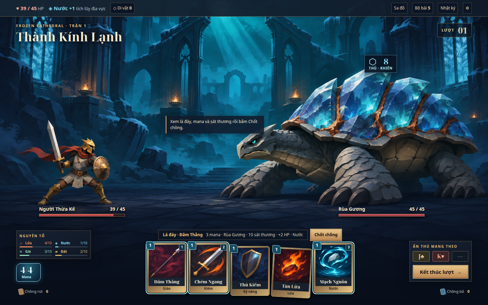

# Ashborne — Định hướng mỹ thuật v0.2 · Bố cục và luồng v0.3

**Cập nhật 18/11/2026:** chuẩn style chung và font hiện hành nằm tại [Ashborne — Style art chung](Ashborne-Style-Art-Chung.md). Ảnh `approved-scene-v2.png` áp dụng cho mọi thành phần; font đã chọn là **Ashborne Veil v0.3**. Khi các hướng vật liệu, nét vẽ hoặc chữ bên dưới khác chuẩn mới, ưu tiên file style chung. Các mockup và luồng mô tả ở đây là tài liệu tham chiếu cũ, cần đối chiếu luật gameplay hiện hành khi dùng tiếp.

Ashborne là dark fantasy 2D với cảnh chiến đấu vẽ tay theo mảng khối. Người Thừa Kế mặc giáp vàng cũ và khăn đỏ, đối đầu với những sinh vật có tỉ lệ lớn hơn hẳn. Trong Thành Kính Lạnh, đá đen xanh lùi vào nền, ánh đèn hổ phách bắt trên kim loại và ánh xanh lạnh vỡ thành mảng trên mai Rùa Gương. Chủ đề của chiến dịch là giành lại các thành bằng nguồn sức mạnh đã từng phá hủy vương quốc. Trong trận, cái giá của việc dùng sức mạnh ấy xuất hiện ngay trên thanh nguyên tố và HP.

[Mở bản xem thử từ đầu](art/v2/index.html) · [Xem bộ ảnh tĩnh](art/v2/previews) · [Xem tranh gốc](art/v2/media) · [Bản v0.1](art/concept/archive/Ashborne-Art-Direction-v0.1.md)

## Cách dùng bốn ảnh tham chiếu

| Ảnh | Chi tiết dùng cho Ashborne |
| --- | --- |
| Phế tích xanh, chiến binh và sư tử vàng | Tranh chia mảng sáng tối rõ, bóng dáng mạnh, lệch tỉ lệ giữa người và quái. Tạo hình lại cảnh, nhân vật và Rùa Gương. |
| Ảnh giao tranh ngang | Nhân vật trái, địch phải, ý đồ trên địch, sinh lực dưới chân và tay bài dưới màn. Ashborne thêm chồng xem trước ở giữa, thanh bốn nguyên tố bên trái và khay ba ấn bên phải. |
| Lá bài khóa kim loại | Hạng và chất trên mép dọc, tranh chiếm phần lớn mặt lá, có khóa kim loại và bản tên tách ô luật. Áp dụng nguyên bố cục này cho Ấn Thú. |
| Bản đồ màu nước trên giấy cổ | Địa hình vẽ bằng mực nâu, hatching, màu nước và mốc kiến trúc. Dùng địa lý riêng của Ashborne và đặt định tuyến ở lớp tương tác bên trên tranh. |

## Tranh và màu

- **Cảnh đấu.** Tầm máy ngang, sàn sâu về sau và đường chân trời thấp. Đặt mục tiêu đủ lớn để đọc thế thủ và bộ phận báo đòn. Vùng giữa nhân vật và địch dành cho chuyển động khi ra đòn. Giảm tương phản dưới tay bài và quanh số HP. Cảnh mẫu là một bức tranh liền, khi dựng game cần tách nền, sàn, nhân vật, quái và hiệu ứng thành các lớp.
- **Người Thừa Kế.** Mũ góc cạnh, khăn đỏ kéo sang trái và khiên tròn nhỏ. Vàng xước tập trung ở mũ, tay và chân để dáng nhân vật đọc được trước đá xanh đen.
- **Rùa Gương.** Đầu thấp, mắt xanh, thân đá phiến, mai là các tấm kính cobalt viền đồng. Giữ ba đặc điểm ấy khi đổi góc nhìn sang chân dung Ấn Thú. Khi thủ, đầu hạ dưới mai. Khi chuẩn bị tấn công, chân trước bám sàn và đầu hướng về người chơi.
- **Màu.** Xanh đen `#0B1524` cho nền UI, ngà `#F5E9CE` cho chữ, đồng `#E5BD73` cho đường viền và nút chính. Lửa `#F68F60`, Nước `#80D9ED`, Gió `#9BDFBD`, Đất `#DFBC72` đi cùng biểu tượng và tên viết. Các mã này là tham chiếu từ bản cũ; đối chiếu [style chung hiện hành](Ashborne-Style-Art-Chung.md) khi dựng lại. Font hiện hành là **Ashborne Veil v0.3**: Italic cho tiêu đề, Medium cho nút/chỉ số và Regular cho nội dung.

## Luồng mở đầu

Trong [Slay the Spire 2 — gameplay 0:00–2:30](https://www.youtube.com/watch?v=NhfIsNV_Oew), khoảng 0:00–0:20 đi từ menu qua lựa chọn bật hướng dẫn vào trận. Khoảng 0:20–0:40 minh họa đánh bài, Khiên và ý đồ trên chính sân đấu. Sau trận đầu, khoảng 1:20–1:40, video chuyển sang nhận thưởng, chọn lá rồi mở sa đồ. Từ đó đến 2:30, người chơi vào trận tiếp theo và đọc ý đồ theo từng mục tiêu.

Ashborne dùng một hành động chính ở mỗi màn. Menu đặt lựa chọn bắt đầu dưới tên game. Từ đó người chơi chọn vũ khí ưu tiên rồi lập đạo quân ở Thành Kính Lạnh. Người chơi chọn hai lá, xem đơn vị ghép và phá cổng để vào PvE. Hướng dẫn tự hiện ngay trong trận đầu. Game nhắc đánh ở lượt Rùa Gương dựng Khiên, giới thiệu chồng bài sau lần dùng lá đầu và nhắc Thủ Kiếm khi ý đồ đổi sang tấn công.

**Mở đầu → Chọn vũ khí → Lập quân → Phá cổng → Đấu Rùa Gương → Thu 7♦ → Sa đồ.** Thắng trận đưa lá thưởng ra ngay trước khi quay lại atlas. Người chơi có thể mở Sổ Phong Ấn hoặc tiếp tục xem tuyến. Sa đồ ghi nhận 7♦ đã thu và giữ các mốc tuyến. Nếu thua, nút thử lại đưa người chơi về bước lập quân. Sa đồ vẫn mở được từ đầu cho người muốn xem chiến dịch trước.

Màn chọn vũ khí đặt thông tin bên trái, tranh ở bên phải và các lựa chọn ở hàng dưới. Demo có Kiếm và Giáo. Lựa chọn đổi lá đứng đầu tay bài, giữ các lá còn lại để người chơi thử chồng phối vũ khí.

[Ảnh mở đầu](art/v2/previews/00-mo-dau.png) · [Ảnh chọn vũ khí](art/v2/previews/08-chon-vu-khi.png) · [Ảnh màn thu ấn](art/v2/previews/07-thu-an.png)

## Sa đồ và công thành

Atlas mang bốn vùng có dáng địa hình và mốc riêng. **Storm Frontier** có vách xanh xám, cờ và caravan. **Frozen Cathedral** có sườn băng trắng xanh và thành hai tháp. **Ashlands** có miệng lò lửa và rừng cháy. **Stone Grave** có mộ bậc và tượng đá khổng lồ nằm ngang. Atlas nằm giữa màn, hậu cần phía trái và tuyến đang chọn phía phải. Hậu cần hiển thị quân sẵn có, lương, trung thành và danh tiếng theo số liệu mẫu của GDD. Chọn vùng để xem hành trình, loại nút và điểm công thành. Trong mockup, các địa danh phụ và vị trí trên atlas là đề xuất tạo hình.

Tại Thành Kính Lạnh, lớp sa đồ dẫn từ trại, qua Cầu Kính, đến cổng đôi. Màn lập quân dùng ba lá minh họa **Cự nhân núi + Khiên binh II → Cự nhân núi Khiên binh II**. Lá chủng giữ gương mặt, lá binh chủng mang trang bị, lá kết quả ghép cả hai. Đây là ví dụ theo hệ ghép đã chốt trong [Chủng tộc và Binh chủng](Ashborne-Chung-toc-va-Binh-chung.md). [Ảnh sa đồ](art/v2/previews/01-sa-do.png) · [Ảnh công thành](art/v2/previews/02-cong-thanh.png)

## HUD giao tranh

[Bộ màn UI/UX tương tác](art/v2/ui-atlas.html) · [Đối chiếu tài nguyên và quyết định luật](Ashborne-UI-UX.md)

| Cụm | Cách đọc |
| --- | --- |
| Mép trên của trận | HP xuyên trận, buff địa vực và di vật. Cạnh phải mở tuyến, bộ bài, nhật ký và tùy chọn trong bảng tại chỗ. |
| Trên quái | Ý đồ có biểu tượng, lượng và nhãn. Rùa Gương mở bằng Thủ 8 Khiên theo màn mẫu. |
| Dưới hai nhân vật | Tên, HP và Khiên theo đúng vị trí trên sàn. |
| Tay bài và chồng | Bài xòe nhẹ, có mana và tên. Khi chọn, số thứ tự hiện ở góc, vùng ngay trên tay bài cho biết lá đáy, tổng mana, mục tiêu, sát thương và nguyên tố. Nút Dùng lá hoặc Chốt chồng nằm cạnh phần xem trước. Bấm lại để tháo lá. |
| Tích nguyên tố | Bốn thanh có màu, glyph và số. Mốc đầy có nhãn Chờ quá tải. Khi kích hoạt, nhãn nêu hệ và lượng HP mất cuối lượt. |
| Hai góc dưới | Mana có huy hiệu riêng cạnh bốn thanh nguyên tố bên trái. Ấn Thú và Kết thúc lượt ở phải. Chồng rút nằm ở góc trái và chồng bỏ nằm ở góc phải. Ô Ấn Thú thứ ba để trống trong lần gặp Rùa Gương đầu tiên. |
| Phản hồi lượt | Sát thương và Khiên hiện gần đối tượng nhận hiệu ứng. Khi kết thúc lượt, một dòng ngắn cho biết Rùa Gương vừa làm gì và người chơi đang ở lượt nào. |

Bản xem thử có một tay bài cố định, xem và chốt chồng, phản ứng Khiên, Tiết Chế, Quá tải và màn thu ấn. Số cộng minh họa cho Tàn Lửa và Mạch Nguồn, HP mở màn và một số giá trị thanh được đặt để diễn thử bố cục. Hệ rút bài, luật dùng Ấn Thú và tính toán đầy đủ thuộc bản game. Bản xem thử kết thúc ở atlas sau trận Rùa Gương, các vùng còn lại có thể mở để xem thông tin tuyến. [Luật tham chiếu](Ashborne-Concept-The-Combat.md) · [Ảnh giao tranh điện thoại](art/v2/previews/06-giao-tranh-mobile.png)

## Thiết kế mặt thẻ

- **Ấn Thú.** Mép trái mang chất và hạng, dấu đối góc giúp đọc khi nhìn ngược lá. Khóa ở chính giữa mép trên đóng khung kim loại quanh tranh. Tranh chiếm khoảng hai phần ba chiều cao, tên trên dải sẫm, luật trên nền giấy sáng. Khung thử dùng đồng xước, giấy ngà và mực xanh đậm cho 7♦. Cả bốn chất có thể dùng lại cùng lưới, đổi glyph, mực và vật liệu điểm.
- **Vũ khí và Nguyên tố.** Viền gọn hơn để đọc cả tay bài. Cách bố trí nhất quán gồm mana ở góc, một hình chính và tên ở đáy. Mỗi lá dùng một bóng dáng chi phối như lưỡi kiếm, mũi giáo hay vòng nước. Chi tiết luật có thể mở ở chế độ xem lớn.
- **Quân đội.** Giữ tên họ lá và bậc trong mặt thẻ. Dùng lại gương mặt, màu da và tỷ lệ chủng giữa chân dung gốc và phiên bản ghép. Minh họa ghép riêng cho những tổ hợp cần xuất hiện trong hướng dẫn hoặc cốt truyện.

[Ảnh sổ phong ấn](art/v2/previews/04-so-phong-an.png) · [Mặt lá 7♦ riêng](art/v2/previews/05-la-7-ro.png) · [Các prompt tạo tranh](art/v2/prompts.md)
