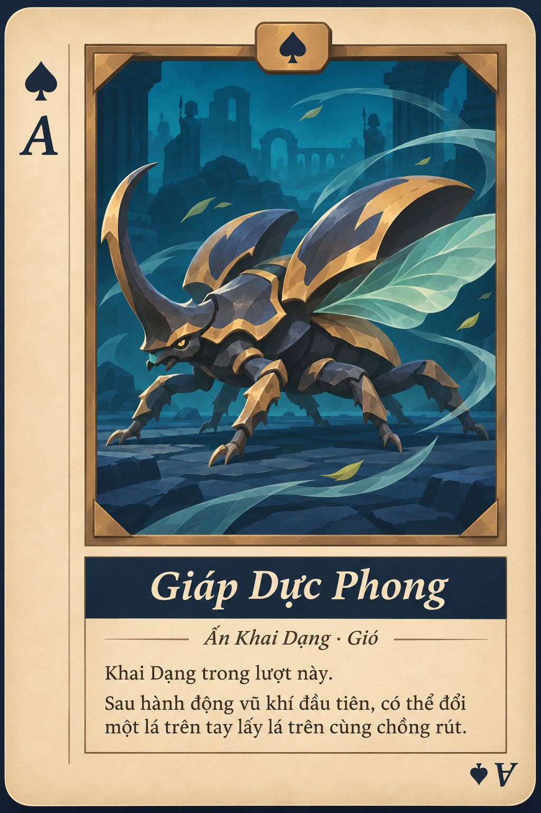
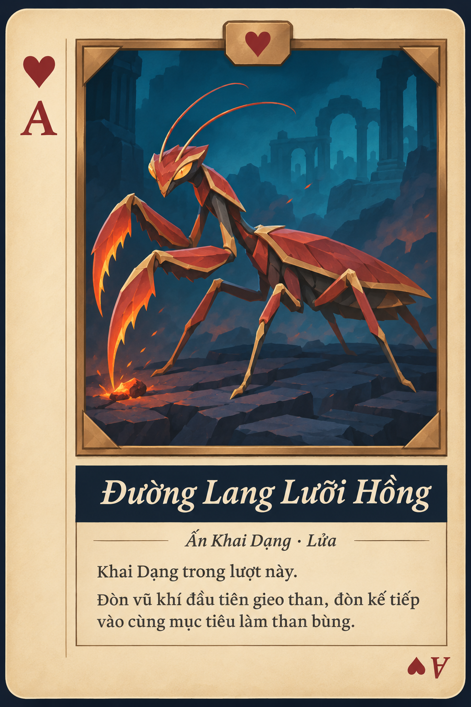
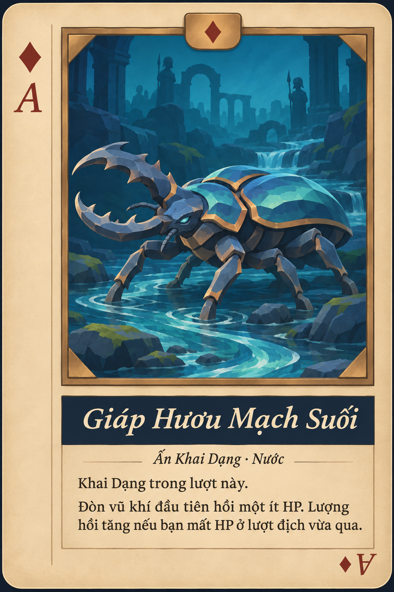
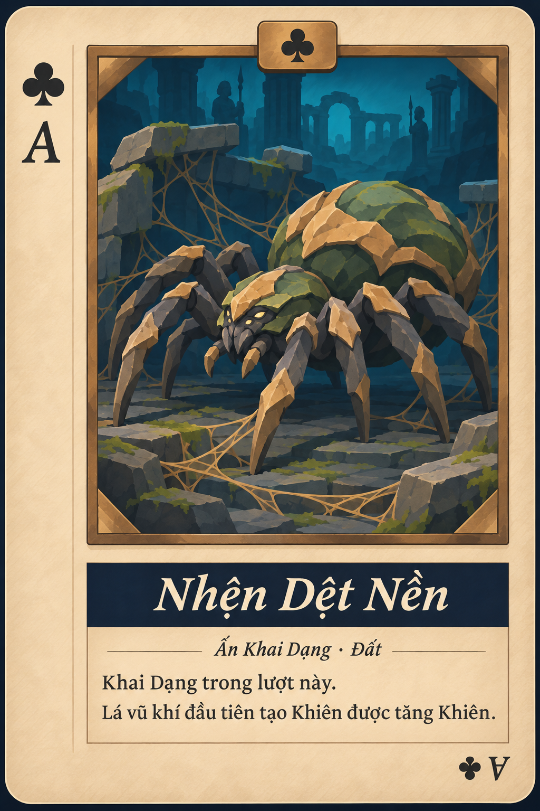

# Ashborne — Bộ bốn lá A đã duyệt

**Bản art v01 · Được người dùng duyệt ngày 18/11/2026**

## 1. Trạng thái và phạm vi

Người dùng đã chấp nhận hình ảnh bộ bốn lá A sau khi xem các bản tạo thử. Lưu bộ này làm **mẫu art mặt thẻ Ấn Thú đã duyệt**, dùng để đối chiếu khi sản xuất tiếp.

Phần được ghi nhận gồm cách thể hiện bốn sinh vật, cách phối màu theo chất–nguyên tố, chất tranh, vật liệu khung và tổ chức thông tin trên mặt thẻ. Công dụng lấy từ danh mục concept hiện hành, không phát sinh thêm thông số cân bằng.

Đây là bốn ảnh mặt thẻ đã ghép phẳng. Việc duyệt art không có nghĩa đã hoàn thành tách lớp, dàn chữ bằng font thật, kiểm tra mọi kích thước hoặc tích hợp vào game.

## 2. Danh mục và file ảnh

| Lá | Chất · Nguyên tố | Tên Ấn Thú | Hình tượng | File |
| --- | --- | --- | --- | --- |
| A♠ | Bích · Gió | **Giáp Dực Phong** | Bọ tê giác. | [A-spades.png](art/aces/v01/A-spades.png) |
| A♥ | Cơ · Lửa | **Đường Lang Lưỡi Hồng** | Bọ ngựa. | [A-hearts.png](art/aces/v01/A-hearts.png) |
| A♦ | Rô · Nước | **Giáp Hươu Mạch Suối** | Bọ hươu. | [A-diamonds.png](art/aces/v01/A-diamonds.png) |
| A♣ | Tép · Đất | **Nhện Dệt Nền** | Nhện. | [A-clubs.png](art/aces/v01/A-clubs.png) |

Cả bốn thuộc nhóm **Ấn Khai Dạng**, mượn đặc tính của thú và thay đổi cách chơi trong một lượt. Hai lá bọ cánh cứng giữ hai hình tượng riêng vì đồng hạng: bọ tê giác của A♠ và bọ hươu của A♦.

## 3. Mẫu mặt thẻ chung

- Thẻ dọc, bốn góc bo; nền giấy ngà ấm.
- Cột chỉ số hẹp bên trái: biểu tượng chất phía trên, chữ A phía dưới.
- Khung tranh màu đồng/vàng cũ, mặt màu có nét vẽ tay; các góc giữ tranh được tiết chế.
- Khóa/chốt nhỏ ở giữa mép trên khung tranh, mang biểu tượng chất.
- Tranh sinh vật chiếm phần lớn vùng trên, có bối cảnh phế tích và không khí theo style chung.
- Dải tên xanh than đặt dưới tranh, chữ ngà sáng mang dáng nghiêng mềm.
- Dòng phân loại bên dưới tên: **Ấn Khai Dạng · [Nguyên tố]**.
- Nội dung công dụng nằm trên vùng giấy sáng phía dưới.
- Góc dưới phải có A và chất đảo chiều để giữ nhận diện bài tây.
- ♠ và ♣ dùng sắc tối; ♥ và ♦ dùng đỏ trầm. Chất vẫn phải đọc được độc lập với màu của tranh.

Giữ các vai trò và thứ bậc này khi phát triển thẻ tiếp theo. Khi dựng component thực tế, dùng một lưới chung để thống nhất khoảng cách và kích thước; không lấy những sai khác nhỏ giữa bốn ảnh raster làm bốn quy chuẩn riêng.

## 4. A♠ — Giáp Dực Phong

**Phân loại:** Ấn Khai Dạng · Gió.

**Công dụng theo concept:**

> Khai Dạng trong lượt này. Sau hành động vũ khí đầu tiên, có thể đổi một lá trên tay lấy lá trên cùng chồng rút.

**Đặc điểm hình ảnh cần giữ:**

- Sừng lớn cong lên là dấu nhận diện bọ tê giác.
- Cánh giáp mở, để lộ cánh bay màu xanh ngọc nhạt.
- Khối giáp xanh than/xám đậm, các mặt vàng ấm tạo trọng tâm.
- Dải gió và lá bay biểu đạt nguyên tố; vẫn đọc được cơ thể và chi.
- Phế tích xanh phía sau giảm độ nổi, giữ sinh vật là chủ thể chính.

## 5. A♥ — Đường Lang Lưỡi Hồng

**Phân loại:** Ấn Khai Dạng · Lửa.

**Công dụng theo concept:**

> Khai Dạng trong lượt này. Đòn vũ khí đầu tiên gieo than, đòn kế tiếp vào cùng mục tiêu làm than bùng.

**Đặc điểm hình ảnh cần giữ:**

- Đầu bọ ngựa, râu dài, phần ngực kéo và cặp chi trước dạng liềm.
- Thân đỏ gạch/đỏ hồng sẫm, mặt nhấn vàng ấm, khớp tối.
- Mép liềm bắt ánh than, liên hệ với đốm than dưới chân.
- Lửa có điểm phát sinh rõ và được tiết chế để không che hình thể.
- Giữ dáng sinh vật săn mồi; không chuyển thành chiến binh hình người hoặc giáp máy.

## 6. A♦ — Giáp Hươu Mạch Suối

**Phân loại:** Ấn Khai Dạng · Nước.

**Công dụng theo concept:**

> Khai Dạng trong lượt này. Đòn vũ khí đầu tiên hồi một ít HP. Lượng hồi tăng nếu bạn mất HP ở lượt địch vừa qua.

**Đặc điểm hình ảnh cần giữ:**

- Cặp hàm lớn phân nhánh/răng cưa nhận diện bọ hươu, khác sừng đơn của A♠.
- Vỏ xanh lam–aquamarine, điểm nối vàng đồng có tiết chế.
- Thế đứng nặng trên đá và dòng suối nông; gợn nước thể hiện tiếp xúc.
- Dòng nước luân chuyển qua tranh tạo cảm giác phục hồi và mạch suối.
- Giữ hình thể bọ hươu; không biến cánh giáp thành mai rùa hoặc thay hệ Nước bằng băng phủ kín.

## 7. A♣ — Nhện Dệt Nền

**Phân loại:** Ấn Khai Dạng · Đất.

**Công dụng theo concept:**

> Khai Dạng trong lượt này. Lá vũ khí đầu tiên tạo Khiên được tăng Khiên.

**Đặc điểm hình ảnh cần giữ:**

- Nhện có phần đầu-ngực và bụng tách khối, các chân dài chống rộng tạo sức nặng.
- Hệ màu graphite, xanh khoáng/rêu trầm và mặt đá/vàng đất.
- Tơ nối các mảng đá và công trình đổ vỡ, liên hệ hình tượng dệt nền và củng cố phòng thủ.
- Mắt là điểm sáng nhỏ, không phủ glow lên toàn thân.
- Giữ nhận diện nhện với tám chân; phân biệt chân với phần phụ miệng khi tách lớp hoặc dựng góc nhìn mới.

## 8. Chuẩn art dùng để đối chiếu

Ảnh chuẩn chung vẫn là [approved-scene-v2.png](art/style-reference/approved-scene-v2.png). Bộ bốn lá A là mẫu áp dụng đã được duyệt cho mặt thẻ, không thay thế chuẩn toàn cảnh.

Các đặc điểm chung cần tiếp tục giữ:

1. Hình lớn, silhouette rõ và màu chia theo mặt khối.
2. Đường bao hữu cơ, vật liệu có sức nặng, nền lùi nhờ lớp màu và không khí.
3. Điểm nhấn ấm có chọn lọc trên nền lạnh trầm; nguyên tố từng chất vẫn có bản sắc riêng.
4. Mật độ chi tiết đủ cho thẻ, không đổi sang ảnh thật, kim loại bóng gương hoặc noise dày.
5. Hình sinh vật chi phối tranh; khung và trang trí hỗ trợ nhận diện.
6. Giữ cùng chủ thể và các điểm nhận diện khi phát triển sprite, chân dung hoặc các bản thẻ khác.

Tham chiếu triển khai: [Style art chung](Ashborne-Style-Art-Chung.md) và [Đặc tả sản xuất art ingame](Ashborne-Dac-Ta-Art-Ingame.md).

## 9. Font và bước chuyển sang asset ingame

Font đã chốt là **Ashborne Veil v0.3**: Italic cho tên/tiêu đề, Medium cho phần cần nhấn và Regular cho mô tả.

Chữ trong bốn PNG là chữ raster do ImageGen tạo theo ảnh mẫu font, không phải kết quả dàn trực tiếp bằng TTF. Khi triển khai:

- Tách tranh, khung, khóa, ký hiệu chất và các vùng UI cần điều khiển.
- Dàn lại chữ bằng [bộ font Veil v0.3](art/fonts/ashborne-veil-v03/Ashborne-Veil-v03.zip), giữ đúng tên và dấu tiếng Việt.
- Dùng chung component cho vị trí hạng/chất, dải tên, nhãn phân loại và phần luật.
- Kiểm tra ở kích thước thư viện, xem chi tiết và khay ấn; nội dung đầy đủ phải tra được khi cần.
- Trạng thái chưa dùng/đã dùng và điểm ấn thuộc UI gameplay, không vẽ cố định vào tranh.

Không thêm mana, điểm kích hoạt, HP hoặc chỉ số sát thương tùy ý vào bộ mẫu này. Chi phí Ấn Thú và các giá trị cụ thể tiếp tục theo đặc tả gameplay khi được chốt.

## 10. Nguồn và gói lưu trữ

- [Concept thẻ combat](Ashborne-Concept-The-Combat.md): tên, sinh vật, chất–nguyên tố và công dụng của bốn lá A.
- [GDD/FDD](Ashborne-GDD-va-FDD.md): Ấn Thú dùng điểm riêng, mỗi lá một lần xuyên cuộc công thành; bộ mang theo tối đa ba ấn. Bộ bốn lá trong tài liệu là bộ mẫu art, không có nghĩa được mang cả bốn vào cùng lúc.
- [Prompt đầy đủ của bốn ảnh](art/aces/v01/generation-prompts.json): tạo bằng **ImageGen tích hợp**; dùng ảnh cảnh chuẩn cho chất tranh, ảnh Veil cho hướng chữ và thẻ 7♦ cũ cho bố cục.
- [Danh mục Markdown đã rà trước khi tạo](art/aces/v01/markdown-read-manifest.json): 33 file, gồm tài liệu hiện hành và lịch sử.
- [Gói ảnh và prompt v01](art/aces/v01/Ashborne-four-aces-v01.zip): gói đã tạo cùng bộ ảnh; file Markdown này được lưu riêng tại thư mục gốc dự án.

Giữ nguyên bốn PNG v01 làm mốc duyệt. Khi có chỉnh sửa, lưu phiên bản mới để còn đối chiếu; không ghi đè bộ đã duyệt.

**Lưu ý khi chuyển tài liệu:** file Markdown hiển thị ảnh bằng liên kết tới `art/aces/v01/`. Muốn mang tài liệu sang nơi khác, giữ cấu trúc thư mục và các ảnh đi kèm.
