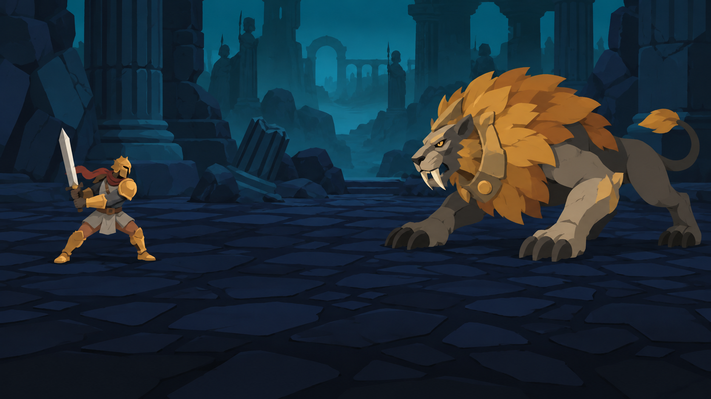

# Ashborne — Đặc tả sản xuất art ingame

**Phiên bản 1.0 · 18/11/2026 · Chuẩn hình ảnh: approved-scene-v2.png · Font: Ashborne Veil v0.3**

## 01. Mục tiêu và cách dùng

Tài liệu dùng để giao việc, tạo asset, ghép cảnh và nghiệm thu art trong game. Mục tiêu là tái hiện **ngôn ngữ tạo hình, độ hoàn thiện và khả năng đọc** của ảnh chuẩn ở kích thước chơi thực tế.

Đọc cùng [Style art chung và quyết định đã chốt](Ashborne-Style-Art-Chung.md). Khi tài liệu mỹ thuật, ảnh hoặc demo cũ khác hướng, ảnh chuẩn và lựa chọn font hiện hành được ưu tiên về style. Luật, dữ liệu và flow chơi theo [GDD/FDD](Ashborne-GDD-va-FDD.md) và [UI/UX hiện hành](Ashborne-UI-UX.md).

**Phân biệt ba loại thông tin:**

- **Đã chốt:** ảnh chuẩn áp dụng cho toàn game; font Ashborne Veil v0.3 với nét mềm, hơi ma mị và nhấn–nhả nhẹ.
- **Đặc tả triển khai:** các quy tắc dưới đây chuyển đặc điểm của ref thành yêu cầu sản xuất có thể kiểm tra.
- **Thông số hướng dẫn:** tỷ lệ khung hình, màu lấy mẫu và số mảng gợi ý giúp dựng bản đầu. Chúng không thay thế việc đối chiếu trực tiếp với ảnh, cũng không tự chốt engine, độ phân giải đích hay thông số animation.

Một ảnh ref không cung cấp đủ thiết kế của mọi mặt nhân vật, chuyển động hoặc UI. Những phần mở rộng phải giữ cùng ngôn ngữ thị giác và được kiểm tra bằng bản dựng trong cảnh. Tài liệu là chuẩn kiểm soát chất lượng; kết quả vẫn cần vòng dựng–so sánh–sửa, không chỉ một câu prompt.

## 02. Ảnh chuẩn



- File trong dự án: [approved-scene-v2.png](art/style-reference/approved-scene-v2.png).
- Nguồn người dùng: `/home/vinhdt/Desktop/DataHDD/card_game/art-direction/approved-scene-v2.png`.
- Kích thước ảnh: **1672 × 941 px**, gần tỷ lệ 16:9.
- Bản trong dự án là bản sao nguyên vẹn, giữ để đối chiếu; không dùng làm file làm việc để vẽ đè.

Ảnh chuẩn là một tranh đã ghép hoàn chỉnh. Không coi phần hình nhìn thấy của người/quái là sprite đã sẵn sàng rig hoặc phần nền là background sạch đã có đủ dữ liệu bị che.

## 03. Công thức thị giác cần giữ

> Fantasy 2D vẽ tay theo mảng khối lớn; đường bao rõ và hữu cơ; vật liệu được diễn tả bằng các mặt màu; nền lạnh trầm có chiều sâu không khí; chủ thể có điểm nhấn ấm; chi tiết vừa đủ để đọc khi chơi.

### Các trụ cột bắt buộc

1. **Đọc khối trước chi tiết:** nhận được người, quái, tư thế và phần cơ thể chính trước khi thấy vết nứt hay trang trí.
2. **Tô theo mặt màu:** sáng–trung–tối chia thành các mảng có hình; không làm toàn bộ thể tích bằng tô loang mịn.
3. **Biên có chủ đích:** cạnh chủ thể quan trọng rõ hơn; vật xa và không khí mềm, ít tương phản hơn.
4. **Một hệ ánh sáng:** các lớp đứng chung không gian, có cùng logic sáng–tối và bóng tiếp xúc.
5. **Phân cấp màu:** chủ thể, nền, hiệu ứng và UI có vai trò riêng, không cùng tranh mức sáng và bão hòa.
6. **Cùng chất vẽ giữa các nhóm asset:** nhân vật, tranh thẻ, icon và vật liệu UI không trông như lấy từ những bộ game khác nhau.
7. **Đánh giá ở trong cảnh:** một asset đẹp trên nền trống chưa đủ điều kiện đạt.

Chất ma mị nằm ở khoảng tối, lớp sương, kiến trúc cổ và nhịp chữ mềm. Không mặc định thêm glow tím, hoa văn hoặc hạt bụi vào mọi thành phần.

## 04. Bóc tách ref thành quyết định tạo hình

| Chi tiết trong ref | Cách tạo ra cảm giác đó | Yêu cầu sản xuất |
| --- | --- | --- |
| Chiến binh nhỏ nhưng vẫn đọc rõ. | Mũ, giáp vai, kiếm, chân và khăn tạo các khối nhận diện; vàng ấm tách khỏi nền. | Giữ silhouette và các điểm nhận diện ở kích thước chơi; không phụ thuộc chi tiết trên mặt. |
| Sư tử lớn có sức nặng. | Đầu thấp, chân trước bám rộng, thân nối khối rõ; bàn chân tiếp xúc sàn. | Giải phẫu cách điệu phải có cấu trúc chịu lực; contact và bóng làm chủ thể đứng vững. |
| Bờm phong phú nhưng gọn. | Tách thành cụm lớn có lớp chồng và đổi sắc vàng. | Vẽ cụm lông, không phủ sợi nhỏ đều khắp bờm. |
| Giáp đọc ra kim loại. | Mặt vàng sáng, mặt vàng sẫm, cạnh sáng được chọn lọc. | Diễn tả vật liệu qua mặt khối; không dùng phản chiếu bóng gương để thay thế tạo hình. |
| Đá có bề mặt mà không bị bẩn. | Mặt gãy và khe tối lớn, ít vết nứt phụ. | Texture đi theo khối và tỷ lệ; không rải noise hoặc vết xước đồng đều. |
| Phế tích sâu. | Nhiều lớp cột, tượng, vòm; càng xa càng ít sắc độ và hòa vào xanh sương. | Tách lớp xa–giữa–gần cả về hình, tương phản và màu không khí. |
| Sàn dẫn mắt vào cảnh. | Phiến gần lớn, phiến xa nhỏ; đứt quãng và bất quy tắc. | Giữ phối cảnh, tránh lặp pattern phẳng hoặc vết chia đá đồng cỡ. |
| Sân có chỗ thở. | Khoảng giữa hai bên và vùng sàn dưới không đầy chi tiết nổi. | Dự trù vùng đánh, bài, VFX, HP và tooltip ngay từ bản dựng khối. |

## 05. Ngữ pháp hình khối và đường nét

### 5.1. Dựng hình

- Bắt đầu bằng bóng dáng và 3–5 khối chính làm bài tập dựng hình: đầu, ngực, thân/chậu, cụm chi, vật nhận diện. Đây là cách tổ chức, không phải giới hạn số bộ phận.
- Khối giáp và đá có mặt cắt; đường bao sinh vật có nhịp lồi–lõm, chỗ căng/chỗ thu để tránh cảm giác mô hình ghép đa giác.
- Ưu tiên hình lớn, rồi hình vừa, cuối cùng mới thêm chi tiết nhỏ. Mỗi cấp phải phục vụ cấp trước.
- Giữ bất đối xứng tự nhiên ở bờm, vết vỡ, vải, trang trí; những phần cần đồng dạng để nhận diện vẫn phải nhất quán.
- Không làm mọi góc thành mũi nhọn. Ref có cả góc gãy của vật liệu và đường cong ở cơ thể, bàn chân, khăn, đuôi.

### 5.2. Đường bao

Tách hình bằng màu và sắc độ là chính. Chỉ dùng nét/khe tối nơi có tiếp giáp, chồng lớp hoặc cần nhấn cấu trúc. Không viền đen dày, đều quanh mọi chi tiết.

Mép mảng được phép hơi tự nhiên nhưng phải sạch khi thu nhỏ. Không cố tạo cảm giác vẽ tay bằng cách làm viền rung, răng cưa hoặc nhòe toàn bộ hình.

### 5.3. Kiểm tra silhouette

Khi đưa chủ thể về một màu, vẫn phải nhận được hướng quay, thế đứng, vũ khí chính và bộ phận đặc trưng. Tách tay khỏi thân, vũ khí khỏi đầu và chân trước khỏi chân sau ở những chỗ cần đọc hành động. Các khe quá nhỏ mất khi thu ảnh là dấu hiệu phải sửa hình lớn.

## 06. Cách tô và kiểm soát chi tiết

### 6.1. Trình tự tô chuẩn

1. Khóa hình và nhóm màu nền của từng vật liệu.
2. Đặt vùng sáng, vùng trung gian và bóng lớn theo hướng khối.
3. Thêm mặt chuyển ở nơi cần mô tả thể tích hoặc lớp chồng.
4. Chọn một số cạnh/điểm bắt sáng quan trọng.
5. Thêm chi tiết nhận diện; bỏ chi tiết không còn giá trị ở kích thước chơi.
6. Ghép vào cảnh và cân lại cạnh, màu, độ sáng.

**Gợi ý cho bản dựng đầu:** mỗi vật liệu bắt đầu với khoảng 3–5 nhóm sắc độ; tăng khi cần nhưng không để các sắc độ vụn phá mảng lớn. Không coi con số này là số màu cứng trong file.

### 6.2. Cạnh cứng và cạnh mềm

| Vị trí | Xử lý cạnh |
| --- | --- |
| Silhouette chủ thể, lưỡi kiếm, mép giáp. | Rõ và gọn, ưu tiên đọc hình. |
| Mặt giáp, cụm bờm, mặt đá. | Biên mảng rõ, đổi sắc có tiết chế. |
| Chuyển thể tích da/thịt/vải. | Có thể mềm hơn nhưng vẫn giữ khối chính. |
| Bóng tiếp xúc. | Đậm/rõ ở điểm chạm, dịu ra ngoài khi phù hợp. |
| Sương, cảnh xa và ánh sáng môi trường. | Mềm, giảm chi tiết và hòa màu. |

### 6.3. Phân bổ độ chi tiết

Chi tiết tập trung quanh mặt, mắt, đầu vũ khí, dấu nhận diện và nơi cần báo hành động. Phần thân lớn, mặt sàn dưới UI và vật xa phải có khoảng nghỉ. Không dùng cùng mật độ nét/texture cho nhân vật chính, nền gần và nền xa.

## 07. Palette và sáng–tối

### 7.1. Quan hệ màu

Trong cảnh chuẩn, nền xanh đen/xanh lam lục giữ không gian lạnh; vàng đất và hổ phách kéo chủ thể ra trước; đỏ khăn là điểm nhấn nhỏ; xám đá và ngà nối các nhóm vật liệu.

Điều phải giữ khi đổi biome là **quan hệ vai trò và thứ bậc**, không phải bắt mọi cảnh thành xanh và mọi quái thành vàng. Các màu nguyên tố, phe, vùng và độ hiếm vẫn phải tuân theo dữ liệu game.

### 7.2. Màu lấy mẫu để dựng bản đầu

Các màu dưới đây là trung vị RGB của vùng nhỏ 7×7 px quanh điểm mẫu trong ảnh chuẩn. Tọa độ chuẩn hóa tính từ góc trên trái. Chúng là ví dụ mặt màu cụ thể, không phải palette đầy đủ hay mã bắt buộc cho mọi asset.

| Vai trò / điểm mẫu | Màu | Tọa độ x, y |
| --- | --- | --- |
| Khoảng tối tiền cảnh. | `#0B1019` | 0.470, 0.910 |
| Mặt phiến sàn xanh. | `#142037` | 0.390, 0.740 |
| Mặt đá ở vùng cột. | `#113045` | 0.090, 0.210 |
| Không khí xanh ở xa. | `#136680` | 0.470, 0.240 |
| Mảng vàng bờm. | `#BA7D30` | 0.680, 0.230 |
| Mảng nâu sẫm trong bờm. | `#824E21` | 0.790, 0.310 |
| Mặt thân/chi sáng của sư tử. | `#A58C66` | 0.840, 0.470 |
| Đỏ khăn chiến binh. | `#783629` | 0.139, 0.437 |
| Mặt sáng của kiếm. | `#ECE0CE` | 0.096, 0.380 |

### 7.3. Yêu cầu sáng–tối

- Khi xem ảnh xám, hai bên giao tranh vẫn tách khỏi nền ở các vùng nhận diện chính.
- Các vùng tối phải còn phân lớp. Không phủ một lớp tối toàn màn làm mất chân, vật liệu và mặt sàn.
- Điểm sáng mạnh nằm có chọn lọc ở lưỡi kiếm, cạnh giáp, mắt hoặc nguồn hiệu ứng; không biến mọi cạnh thành viền sáng.
- Vật xa có dải tương phản hẹp hơn chủ thể. Giữ khác biệt giữa lớp sương xa sáng hơn và tiền cảnh tối hơn.
- Cân sáng ở cấp toàn cảnh trước khi tăng sáng riêng từng asset; tránh ai cũng được tăng sáng tới mức không còn thứ bậc.

## 08. Ánh sáng, bóng và tiếp xúc mặt đất

Ref gợi ánh sáng rộng từ phía trên, có các mặt bắt sáng ấm trên chủ thể trong môi trường lạnh. Đây là logic để dựng cảnh chuẩn; cảnh khác có thể có nguồn sáng khác nhưng các lớp phải thống nhất với nhau.

### Ánh sáng trên asset

- Tô sáng theo hướng mặt khối, không tạo một mảng sáng ngẫu nhiên ở giữa mọi vật.
- Nhận diện rõ màu vật liệu gốc, bóng và ảnh hưởng môi trường; không làm vùng bóng chỉ là cùng màu nhân với đen.
- Nếu dùng asset tô sẵn sáng–tối, thiết lập vật liệu/render để ánh sáng runtime không tô thêm một hệ bóng trái hướng.
- Xem bản ghép với cấu hình màu thực tế trước khi kết luận màu file nguồn đã đạt.

### Bóng tiếp xúc

Chân, móng và vật chạm sàn cần đọc ra điểm tì. Bóng nằm dưới hình, không đi theo một vị trí cố định khi chân đã nhấc lên. Khi tách sprite, giữ bóng thành lớp riêng nếu cần điều khiển theo hành động; không mang nguyên một mảng sàn hình chữ nhật theo sprite.

**Chưa đạt nếu:** nhân vật như dán lên nền, bàn chân nổi, bóng không theo hướng sáng hoặc phần cắt alpha để lại viền khác màu.

## 09. Bố cục, camera và sân chiến đấu

### 9.1. Tính chất camera

Camera nhìn ngang chếch vào sàn, thấy mặt đứng công trình và mặt phẳng đất có chiều sâu. Không chuyển thành góc nhìn isometric mạnh hoặc góc từ trên xuống cho sân combat khi đang tái hiện cảnh chuẩn. Các thành phần cùng sân phải dùng cùng mặt đất và logic phối cảnh.

### 9.2. Tỷ lệ tham chiếu trong ảnh

Các khoảng sau ước lượng theo đường bao nhìn thấy, dùng để dựng lại bản chuẩn đầu tiên, không phải lưới bắt buộc của mọi trận:

| Vùng | Phạm vi tương đối |
| --- | --- |
| Chiến binh và kiếm. | Khoảng x 7–22%, y 32–66%. |
| Sư tử gồm thân, bờm, chi và đuôi. | Khoảng x 54–99%, y 16–66%. |
| Vùng chân tiếp xúc. | Quanh y 63–66%, có chênh theo độ sâu từng bàn chân. |
| Khoảng giữa hai bên. | Giữ thoáng ở khu vực tương tác; dùng được cho di chuyển, đòn đánh và hiệu ứng. |
| Sàn dưới. | Mảng phiến lớn, tương phản tiết chế; có thể bị UI che khi ghép gameplay. |

Không suy ra điểm tụ, đường chân trời chính xác hoặc tỷ lệ mét từ những khoảng này. Không bắt mọi quái có kích thước như boss trong ref.

### 9.3. Ghép HUD từ sớm

Ảnh ref không có HUD. Dùng vùng che và các cụm UI hiện hành ngay từ bước dựng bố cục để kiểm tra đầu, vũ khí, chân, intent và HP còn đọc được. Màn hình cần giữ chất tranh khi đã có tay bài, chồng dự tính, Ấn Thú và hiệu ứng; không chỉ đẹp khi tắt UI.

Với tỷ lệ màn khác, quyết định vùng được mở rộng hoặc crop bằng bản layout tương ứng. Không kéo giãn ngang/dọc nhân vật để lấp khung; không tự cắt mất chân, đuôi hay vùng báo đòn quan trọng.

## 10. Đặc tả vật liệu

| Vật liệu | Cách dựng theo ref | Dấu hiệu lệch style |
| --- | --- | --- |
| Đá/kiến trúc. | Mặt phẳng lớn, mép vỡ bất quy tắc, khe tối chọn lọc, phản sắc lạnh. | Noise dày, nứt đều khắp mặt, mọi cạnh sáng như kim loại. |
| Kim loại vàng/đồng. | Mặt sáng ấm, mặt sẫm nâu, vài cạnh sáng và cụm hình giáp rõ. | Chrome bóng gương, highlight trắng dài phủ mọi mép, xước tả thực dày. |
| Thép/lưỡi kiếm. | Mảng dài sạch, mặt sáng ngà và mặt tối rõ, đầu/lưỡi đọc tốt. | Loang phản chiếu phức tạp làm mất hình lưỡi hoặc răng cưa ở kích thước chơi. |
| Lông/bờm. | Cụm lớn xếp lớp có hướng, chỗ sáng–tối khác nhau, silhouette có nhịp. | Từng sợi lông li ti, khối bông mờ hoặc cụm hình lặp đều như răng cưa. |
| Da/cơ thể sinh vật. | Thể tích rõ ở vai, chi, mặt; chuyển mảng mềm hơn giáp. | Cơ bắp tả thực quá mức, bóng nhựa hoặc vùng sáng xóa hết màu da. |
| Vải/khăn. | Nếp lớn theo hướng kéo và trọng lực; mảng màu chủ đạo sạch. | Nếp vụn phủ kín, texture sợi nổi mạnh, vải không liên hệ tư thế. |
| Giấy, kính, băng hoặc chất khác. | Mở rộng cùng mức cách điệu: khối lớn, ít điểm nhận diện, sắc độ có chủ đích. | Mỗi chất mới đổi hẳn sang phong cách ảnh thật/3D. |

Hàng vật liệu chưa xuất hiện rõ trong ref là **quy tắc mở rộng**; cần một mẫu ghép cảnh để xác nhận trước khi dùng hàng loạt.

## 11. Nhân vật, quái và các trạng thái

### 11.1. Hồ sơ thiết kế tối thiểu

- Silhouette, tỷ lệ và hình màu hoàn chỉnh ở góc nhìn dùng trong game.
- Dấu nhận diện: hình đầu, vũ khí, giáp/trang phục, cơ thể và palette.
- Bảng vật liệu, mặt sáng/tối và nơi được phép thêm chi tiết.
- Phần cơ thể/trang phục bị che được dựng đủ cho phạm vi chuyển động dự kiến.
- Mẫu cùng chủ thể ở sprite, chân dung và tranh thẻ để kiểm tra nhận diện.

Không tự đổi tóc, số chi, kiểu giáp, hướng vũ khí, dấu nhận diện hoặc màu chính giữa các frame/asset.

### 11.2. Trạng thái cần thể hiện

Tối thiểu phải kiểm tra tư thế chờ, chuẩn bị hành động, tấn công, chịu đòn, phòng thủ, chết/hạ gục; bổ sung trạng thái theo luật từng chủ thể. Số frame, FPS và thời gian từng pha theo đặc tả animation sau khi xác định cách dựng, không đoán từ ảnh tĩnh.

| Trạng thái | Yêu cầu hình ảnh |
| --- | --- |
| Chờ. | Giữ trọng lượng và nhận diện; chuyển động nhỏ không làm silhouette thay đổi thất thường. |
| Chuẩn bị tấn công. | Thay đổi tư thế đủ để nhận ra hướng và bộ phận sẽ ra đòn. |
| Ra đòn. | Chuyển khối, điểm tì và vũ khí liên tục; không chỉ dịch cả sprite qua lại. |
| Chịu đòn. | Phản ứng rõ nhưng vẫn nhận ra nhân vật; hit flash không xóa hình quá lâu. |
| Phòng thủ. | Tư thế và hiệu ứng cấp Khiên rõ; lượng/hiệu lực đọc qua UI. |
| Buff/debuff. | Phản hồi áp dụng gắn với chủ thể; dấu tĩnh giữ sau VFX; đổi hình thể chỉ khi có ý nghĩa cơ chế. |
| Chết/hạ gục. | Phân biệt trạng thái không còn chiến đấu; tránh nhầm với đang chờ hoặc còn là mục tiêu hợp lệ. |

### 11.3. Tách lớp và animation

Chọn rig 2D hay frame-by-frame theo yêu cầu chuyển động; ảnh chuẩn không quyết định công nghệ. Với rig, chia phần tại chỗ khớp tự nhiên, vẽ bù vùng bị che, đặt lớp trước/sau và giới hạn biến dạng. Với frame-by-frame, giữ cấu trúc, thể tích và mật độ chi tiết ổn định.

Đối với quái nhiều lớp như bờm, đầu, giáp và chân: phần chồng phải đủ che khe khi xoay; tránh lộ hình khớp tròn hoặc đường cắt. Chi tiết tỉ mỉ đứng yên trong khi khối cơ thể biến dạng là dấu hiệu cần sửa rig hoặc tách lại.

## 12. Môi trường và nền sạch

### Bộ lớp khuyến nghị cho một cảnh

| Nhóm lớp | Nội dung | Yêu cầu |
| --- | --- | --- |
| Xa nhất. | Nền trời/không gian màu. | Chuyển sắc hoặc mảng lớn nhẹ, không có chi tiết giành điểm nhìn. |
| Cảnh xa. | Vòm, tượng, cột xa. | Silhouette đơn giản, hòa màu không khí. |
| Trung cảnh. | Cột, nền phế tích, đổ nát. | Đủ cấu trúc để tạo chiều sâu, thấp hơn chủ thể về độ nổi. |
| Sàn. | Phiến đá và vệt chia mặt đất. | Phối cảnh đúng, có mặt sạch để nhân vật di chuyển. |
| Vật che gần. | Đá/cột tiền cảnh nếu cần. | Không che dữ liệu hoặc bộ phận phải đọc khi chơi. |
| Không khí. | Sương và các lớp ánh sáng phụ. | Tách được cường độ; không che mọi lớp bằng một màn mờ. |
| Bóng/tiếp xúc. | Bóng chủ thể và tương tác mặt đất. | Đi cùng vị trí và hành động, không dính cứng vào nền. |

Đây là nhóm chức năng; có thể gộp/tách theo pipeline. Chỉ dùng parallax khi các lớp có đủ hình vẽ để lộ mép và chuyển động mà không tạo khoảng trống.

### Những vùng bắt buộc phải vẽ bù

Nền sau người/quái; sàn dưới chân/bóng; phần sau vật tiền cảnh; phần công trình có thể lộ khi đổi khung hoặc parallax. Không cắt người/quái khỏi ảnh rồi coi các lỗ còn lại là background hoàn chỉnh.

Tắt toàn bộ chủ thể và VFX để kiểm tra nền sạch. Sau đó bật lại từng lớp để kiểm tra tương phản và điểm tiếp xúc.

## 13. Thẻ bài, icon, UI và bản đồ

Ảnh chuẩn không mô tả trực tiếp các lớp này. Những yêu cầu sau chuyển cùng chất tạo hình sang các vai trò khác; bố cục chi tiết phải theo tài liệu UI của game.

| Nhóm | Yêu cầu sản xuất | Cách kiểm tra |
| --- | --- | --- |
| Tranh thẻ. | Cùng mô hình nhân vật/vật liệu/palette với sprite; một chủ điểm hình rõ, nền tranh tiết chế. | Xem trong tay bài và ở chế độ phóng lớn, không chỉ xem bản tranh full. |
| Khung thẻ. | Vật liệu cách điệu, trang trí có nhịp; vùng tên, phí và luật rõ. | Đủ chỗ cho tên dài, dấu Việt, icon và trạng thái chọn. |
| Icon tài nguyên/trạng thái. | Một hình nhận diện mạnh, ít mặt màu, silhouette riêng. | Đọc được ở kích thước nhỏ nhất dự kiến và khi đứng cạnh icon khác. |
| HUD và panel. | Màu nền yên, cạnh tiết chế, ưu tiên nội dung. | Ghép lên cả vùng nền sáng và tối; đọc được HP/mana/intent khi có hiệu ứng. |
| Nút. | Chất liệu cùng hệ, có các trạng thái tương tác khác nhau. | Đọc được nhãn và phân biệt thường/rê/chọn/khóa mà không dựa riêng màu. |
| Tooltip. | Nền phẳng đủ để đọc, phần nhấn có thứ bậc, dấu không bị cắt. | Kiểm tra nội dung dài và nhiều tooltip; không che mất mục tiêu cần so sánh. |
| Bản đồ. | Địa hình, công trình và biểu tượng dùng chung cách chia mảng/màu. | Loại nút, vị trí, tuyến và tiến độ vẫn rõ ở mức zoom chơi. |
| Màn menu/sự kiện/thưởng. | Cùng chất tranh, vật liệu UI và font, bố cục theo một nhiệm vụ chính. | Không có cảm giác chuyển sang một game khác khi ra khỏi combat. |

Không dùng ảnh pixel, icon glossy, khung 3D tả thực hoặc bản đồ hatching dày chỉ vì từng món đẹp riêng. Chất liệu mới cần được diễn tả bằng cùng độ đơn giản của ref.

## 14. Font và trình bày chữ

Font đã chốt: **Ashborne Veil v0.3**. Dùng đúng bộ file, không thay bằng bản Forge, Veil v0.2 hoặc Alegreya gốc.

- [Italic](art/fonts/ashborne-veil-v03/AshborneVeil-Italic.ttf): tiêu đề lớn, tên vùng/tên thẻ khi có đủ không gian, nội dung giàu không khí.
- [Medium](art/fonts/ashborne-veil-v03/AshborneVeil-Medium.ttf): nút, nhãn, chỉ số, phần cần nhấn.
- [Regular](art/fonts/ashborne-veil-v03/AshborneVeil-Regular.ttf): mô tả, luật, hội thoại và tooltip.
- [Mẫu chữ](art/fonts/ashborne-veil-v03/Ashborne-Veil-preview.png), [nguồn và giấy phép](art/fonts/ashborne-veil-v03/SOURCE.txt).

Giữ nét mềm và nhấn–nhả nhẹ. Không giả đậm/giả nghiêng, làm góc chữ cứng lại hoặc thêm viền dày, dập nổi, glow để tạo cảm giác fantasy. Chừa khoảng cho dấu và kiểm tra cả chữ hoa/chữ thường. Nội dung cơ chế vẫn phải dễ đọc, không nghiêng toàn bộ UI.

Thử chữ ở kích thước hiển thị thực tế, qua đường xuất/font atlas thật của engine. Kiểm tra số HP/mana và dấu tiếng Việt sau khi scale; font nhìn tốt trong ảnh mẫu không thay thế bước này. Giữ giấy phép khi đóng gói.

## 15. VFX và lớp phản hồi

VFX dùng các hình chính rõ hướng, nhịp lớn–nhỏ có chủ đích và màu cơ chế nhất quán. Đòn chém có đường đi; Khiên có chủ thể nhận; hồi phục có vị trí phát sinh. Những hạt nhỏ chỉ hỗ trợ hình chính.

- Chỗ phát sáng mạnh ngắn và tập trung; không phủ glow dài lên toàn màn.
- Sau hit, vẫn đọc được silhouette, HP, intent và mục tiêu.
- Hiệu ứng nguyên tố theo màu/biểu tượng trong dữ liệu game; không áp palette cảnh chuẩn lên mọi hệ.
- Hiệu lực còn tồn tại có icon/số/dấu tĩnh; có cách đọc lúc nhận và lúc hết.
- Tách VFX khỏi sprite và khỏi lớp dữ liệu nếu cần điều khiển độc lập. Kiểm tra cộng sáng/alpha trong game, tránh màu render khác file nguồn.
- Ở hành động lặp nhiều lần, VFX không được liên tục chiếm toàn bộ điểm nhìn hoặc xóa chất tranh.

## 16. Yêu cầu file nguồn, xuất ảnh và bàn giao

### 16.1. Hồ sơ mỗi asset

Mỗi asset cần có: mã/tên, nhóm sử dụng, phiên bản, kích thước nguồn, kích thước dự kiến hiển thị, pivot/điểm tiếp xúc nếu có, lớp trước/sau, mô tả vật liệu, trạng thái và những phần còn chờ hoàn thiện. Ghi rõ file nào là nguồn, file nào là bản xuất và ảnh nào là minh họa.

### 16.2. File nguồn

- Giữ file làm việc có lớp hoặc cấu trúc tương đương để sửa hình, palette, vùng bị che và tách chuyển động.
- Giữ riêng ref, bản làm việc và bản xuất. Không ghi đè ref được duyệt.
- Với nhân vật/quái, giữ layer hoặc frame nhất quán về tên, thứ tự và nhận diện.
- Một ảnh tổng hợp đẹp nhưng không thể tách/sửa chưa đủ là bộ asset hoàn chỉnh.

### 16.3. Độ phân giải và scale

Chọn kích thước nguồn từ kích thước lớn nhất cần hiển thị, camera và mức zoom, không chỉ từ tên thiết bị. Có thể lấy nguồn khoảng 2× kích thước đích làm phương án dựng đầu nếu phù hợp bộ nhớ; phải xác minh bằng bản render thật. Không mặc định mọi asset đều 4K và không phóng ảnh nhỏ để coi là tăng chất lượng.

Giữ tỷ lệ nội tại và mật độ chi tiết giữa các asset đứng cạnh nhau. Lọc ảnh/scale phải giữ cạnh gọn, không nhòe hoặc sinh viền. Kích thước atlas, nén texture và cấu hình import được xác định theo engine/nền tảng sau khi có mẫu kiểm chứng.

### 16.4. Alpha và màu

- Sprite/icon/VFX cần trong suốt: xuất định dạng có alpha phù hợp, thông thường PNG RGBA ở bước bàn giao; không còn nền trắng/đen cũ ở rìa.
- Dùng không gian màu thống nhất, ưu tiên sRGB cho ảnh màu và kiểm tra đường import thực tế.
- Thống nhất alpha thẳng/nhân trước theo pipeline render; không trộn lẫn khiến xuất hiện viền tối/sáng.
- Kiểm tra rìa sprite trên cả nền sáng và tối.
- Tách bóng, sương, glow khi các lớp đó cần điều khiển độc lập.

### 16.5. Frame và rig

Giữ canvas, pivot và vị trí chân nhất quán giữa các frame. Nếu trim hoặc đóng atlas làm thay đổi khung, phải có metadata để đặt lại đúng vị trí. Chừa khoảng cho kiếm, đuôi, bờm và tư thế mở rộng; không để animation chạm mép hoặc bị cắt bất ngờ.

## 17. Quy trình sản xuất để đạt chất lượng ref

| Bước | Việc làm | Điều kiện qua bước |
| --- | --- | --- |
| 1. Khóa brief. | Xác định loại asset, vai trò, góc nhìn, vùng hiển thị và các điểm nhận diện. | Không còn mâu thuẫn với gameplay hoặc thiết kế chủ thể. |
| 2. Dựng khối. | Silhouette, tỷ lệ, tư thế, phối cảnh và vùng UI sẽ che. | Đọc đúng chủ thể/hành động khi thu nhỏ. |
| 3. Dựng màu lớn. | Palette và sáng–tối theo cảnh ghép. | Tách chủ thể khỏi nền; cùng hệ ánh sáng. |
| 4. Hoàn thiện vật liệu. | Thêm mặt chuyển, điểm nhấn, chi tiết cần thiết. | Đọc vật liệu mà không tăng texture quá ref. |
| 5. Chuẩn bị asset. | Nền sạch, lớp, vùng vẽ bù, rig/frame, alpha và metadata. | Đủ cho chuyển động và không phát sinh khe cắt. |
| 6. Ghép trong game/bản dựng đúng kích thước. | Dùng camera, UI, cấu hình màu và hiệu ứng thật. | Chất lượng và độ đọc giữ được khi chơi. |
| 7. Đối chiếu và sửa. | So với ref theo từng nhóm tiêu chí bên dưới. | Không còn lỗi cốt lõi về khối, màu, chất vẽ, tiếp xúc và khả năng đọc. |
| 8. Đóng gói. | Nguồn, bản xuất, preview và thông tin phiên bản. | Có thể dùng lại, sửa và truy ngược nguồn. |

Trước khi sản xuất hàng loạt, dựng **một mẫu cảnh chuẩn** gồm người chơi, một quái, nền sạch, bóng tiếp xúc, HUD/tay bài và một hiệu ứng đại diện. Kiểm chứng chất lượng bộ mẫu đó rồi dùng làm mốc cho các asset tiếp theo. Đây là bước sản xuất được đề xuất để giảm lệch style, không phải tuyên bố bộ asset này đã được dựng xong.

## 18. Tiêu chí nghiệm thu

### 18.1. Bắt buộc đạt

| Nhóm | Đạt khi | Chưa đạt khi |
| --- | --- | --- |
| Hình và nhận diện. | Chủ thể, tư thế và đặc điểm chính đọc được ở kích thước chơi. | Chỉ nhận ra khi zoom lớn, chi tiết vụn thay thế hình lớn. |
| Cách tô. | Mảng sáng–tối có hình, giữ khối và nét vẽ tự nhiên. | Tô loang đều, bóng nhựa, faceting máy móc hoặc texture rối. |
| Màu/ánh sáng. | Chủ thể và nền có thứ bậc, vật liệu cùng hệ chiếu sáng. | Nền lấn chủ thể, màu bị tối bệt hoặc các lớp sáng trái nhau. |
| Chiều sâu. | Có lớp gần–giữa–xa và không khí rõ. | Tất cả sắc nét/đậm như nhau, cảnh phẳng. |
| Tiếp xúc. | Chân/bóng/điểm tì khớp với sàn và hành động. | Sprite nổi, trượt hoặc bóng tách khỏi chân vô cớ. |
| Tính đồng bộ. | Sprite, tranh thẻ, icon và UI đọc ra cùng một game. | Mỗi nhóm có chất vẽ, vật liệu hoặc mật độ chi tiết khác hẳn. |
| Animation. | Giữ thể tích, trang bị, palette và nhận diện qua hành động. | Biến dạng khớp lộ, lệch hình giữa frame, nhấp nháy chi tiết. |
| UI/chữ. | HP, mana, intent, bài và dấu Việt rõ khi có VFX. | Art đẹp nhưng che thao tác, chữ bị cắt/nhòe hoặc mất dấu. |
| Bản xuất. | Rìa alpha sạch, tỷ lệ/pivot đúng, màu trong game khớp mục tiêu. | Halo, nền thừa, cắt khung, màu sai hoặc phải upscale để che thiếu chất lượng. |

Một lỗi cốt lõi không được bù bằng nhiều chi tiết đẹp ở phần khác. Ví dụ nền rất đẹp không bù được nhân vật trôi trên sàn hoặc UI không đọc được.

### 18.2. Cách đối chiếu

1. So ref và bản dựng ở cùng kích thước hiển thị, cùng loại crop; không so ref toàn cảnh với một crop nhân vật phóng lớn.
2. Xem màu đầy đủ để kiểm tra khí sắc, vật liệu và trọng tâm.
3. Xem ảnh xám để kiểm tra khối, tương phản và phân lớp.
4. Xem silhouette và thu bản ghép xuống 50% để phát hiện lỗi hình/mật độ chi tiết.
5. Xem đúng kích thước nhỏ nhất dự kiến của sprite, icon, thẻ và chữ.
6. Kiểm tra hình đang chạy: chờ, đòn đánh, VFX, chuyển trạng thái và cảnh có nhiều chủ thể theo thiết kế.
7. Kiểm tra màn có lượng UI/nội dung lớn nhất dự kiến; sau đó kiểm tra các tỷ lệ màn hỗ trợ.

50% là bài kiểm tra độ bền hình ảnh, không phải độ phân giải phát hành đã chốt. Kết quả quan trọng nhất vẫn là ở kích thước chơi thực tế.

### 18.3. Danh sách bàn giao

- [ ] Có bản ghép cạnh ref để đối chiếu chất lượng.
- [ ] Có bản tại kích thước hiển thị thực tế, với UI.
- [ ] File nguồn và lớp/frame cần thiết đầy đủ.
- [ ] Vùng bị che đã vẽ bù theo nhu cầu chuyển động.
- [ ] Pivot, canvas, tỷ lệ, alpha và màu đã kiểm tra.
- [ ] Font đúng Veil v0.3, dấu và chỉ số đọc rõ.
- [ ] Không còn lỗi cốt lõi ở bảng nghiệm thu.
- [ ] Có ghi chú phần chưa thực hiện, không gọi ảnh concept là bộ asset đã hoàn thiện.

## 19. Các lỗi thường gặp và hướng sửa

| Biểu hiện | Nguyên nhân cần kiểm tra | Hướng sửa ưu tiên |
| --- | --- | --- |
| Đúng xanh/vàng nhưng vẫn khác ref. | Sai hình khối, cách tô hoặc mật độ cạnh. | Trở về silhouette và mảng lớn, không chỉ chỉnh màu. |
| Cảnh quá tối và bệt. | Grade/vignette chồng, thiếu phân lớp, bóng phủ đều. | Tách sắc độ từng lớp, giảm lớp tối tổng; giữ chi tiết quan trọng. |
| Nhân vật quá sắc so với nền. | Khác mật độ cạnh/texture hoặc thiếu màu môi trường. | Cân lại cạnh và sắc độ trước khi thêm sương lên toàn hình. |
| Hình trông như low-poly 3D. | Mọi đường cong bị bẻ mặt đều và cơ thể mất nhịp hữu cơ. | Giữ mặt cắt ở vật liệu cứng, phục hồi đường bao và khối cơ thể tự nhiên. |
| Hình trông như tranh vector phẳng. | Thiếu mặt chuyển, lớp chồng, bóng tiếp xúc và không khí. | Bổ sung thể tích và chiều sâu có chọn lọc, không phủ texture. |
| Nhiều chi tiết nhưng không đẹp khi chơi. | Chi tiết nhỏ hơn mức hiển thị và phân bố đều. | Bỏ chi tiết thừa, tăng hình nhận diện, thử lại ở size đích. |
| Mềm thành nhòe. | Airbrush hoặc blur dùng thay cho dựng khối. | Làm rõ biên mảng chủ thể; giữ mềm ở không khí và chuyển thể tích cần thiết. |
| Font cứng hoặc quá trang trí. | Sai phiên bản, giả đậm, viền dày, dùng Italic mọi nơi. | Trở về Veil v0.3 và phân vai Italic/Medium/Regular. |
| Prompt ra tranh đẹp nhưng không dùng được. | Thiếu lớp, góc nhìn, vùng bù hoặc alpha. | Bổ sung yêu cầu sản xuất và kiểm tra asset trước khi nhân rộng. |

## 20. Mẫu brief dùng cho người vẽ hoặc công cụ tạo hình

Điền đủ thông tin trước khi làm; không dùng các ô trống như dữ kiện đã chốt.

```text
Tên/mã asset:
Nhóm: nhân vật / quái / nền / thẻ / icon / UI / VFX / bản đồ
Vai trò gameplay và nơi xuất hiện:
Góc nhìn, tư thế/hành động:
Điểm nhận diện phải giữ:
Vật liệu và màu nhận diện:
Kích thước dự kiến trong màn, camera/zoom:
Vùng UI hoặc vật khác có thể che:
Layer/frame và vùng cần vẽ bù:
Nền trong suốt hay nền cảnh:
Định dạng bàn giao và pivot nếu có:
Ảnh chuẩn đính kèm: approved-scene-v2.png
Mẫu ghép cảnh dùng để đối chiếu:
Tiêu chí đạt và phần cần kiểm tra thêm:
```

### Đoạn mô tả style có thể tái sử dụng

```text
Match the attached approved-scene-v2.png in shape language, rendering
and finish. Hand-painted stylized 2D fantasy, large readable color planes,
organic silhouettes, selective hard edges, restrained surface detail.
Describe material with shaped light/midtone/shadow masses, not dense texture.
Keep subjects readable at the intended in-game size. Use layered atmospheric
depth and a clear foreground/background value hierarchy. Preserve shared
lighting and believable ground contact. Palette follows this asset's biome
and gameplay role while retaining the reference's restrained color hierarchy.
Deliver the specified asset/layers, with clean edges and complete hidden areas
where needed for animation or compositing.
```

### Điều phải loại trừ khi kết quả bị lệch

```text
Photorealistic rendering, glossy plastic or chrome, heavy uniform black
outlines, dense microtexture, noisy scratches, uniformly sharp background,
mechanical polygon faceting across organic anatomy, blurry airbrushed forms,
excessive bloom, cluttered particles, inconsistent anatomy/equipment,
illegible small-scale details, baked-in HUD or text not explicitly requested.
```

Prompt hỗ trợ truyền đạt; ảnh chuẩn, brief của asset và tiêu chí nghiệm thu mới là căn cứ quyết định đạt. Đặc biệt, màu nền lạnh/điểm nhấn ấm của cảnh chuẩn không được ghi đè màu cơ chế hoặc nhận diện đã chốt cho một asset khác.

## 21. Điều kiện kết thúc một hạng mục art

Hạng mục hoàn thành khi **asset ghép trong cảnh giữ đúng chất ref, hoạt động với chuyển động/UI liên quan và có đủ dữ liệu bàn giao để dùng tiếp**. Không dừng ở ảnh concept đẹp hoặc ảnh phóng lớn che giấu lỗi ở kích thước chơi.

Mọi thay đổi về style sau này cần ghi lại rõ để các đợt asset không lệch nhau. Font hiện hành và ảnh chuẩn được giữ cố định cho tới khi người dùng yêu cầu thay đổi.

## 22. Ký tự cổ Vāryan

Bổ sung ngày **27/11/2026**. Với pháp trận, cổ thư, văn khắc và các vật mang nội dung cổ xưa, huyền bí, tham chiếu [ảnh Vāryan](art/script-reference/varyan/varyan-script-reference.png) và [quy ước sử dụng](Ashborne-Varyan-Chu-Co-va-Quy-uoc-Su-dung-v01.md).

- Khi tạo hình có chữ cổ, đưa ảnh Vāryan vào làm ref hình chữ, đồng thời dùng approved-scene-v2.png làm ref chất vẽ. Giữ vai trò từng ảnh riêng.
- Kiểm tra thân chữ, dấu phụ và chuỗi ký tự lặp lại theo cùng bảng; không thay bằng chữ rune/Unicode ngẫu nhiên. Văn khắc có ý nghĩa cần lưu nội dung và cách phiên âm đi kèm.
- Giữ nhịp nét và khoảng trống để chữ không thành texture nhiễu ở kích thước chơi; ánh sáng theo cảnh và cơ chế.
- Nội dung người chơi phải đọc có bản dịch hoặc diễn giải bằng Veil v0.3. Vāryan không thay font cơ chế và HUD.
- Chưa coi ảnh bảng chữ là font, vector hoặc bộ pháp trận dùng được ngay; cần kiểm tra glyph riêng khi sản xuất.
