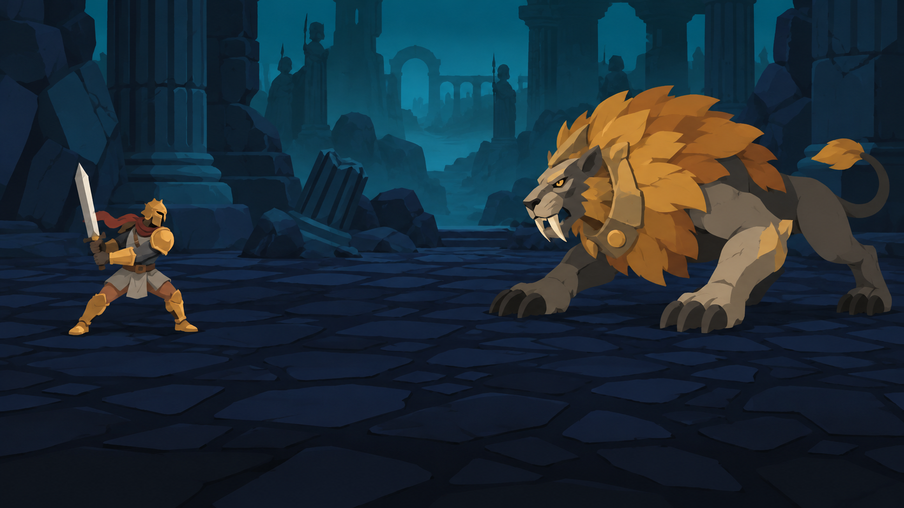

# Ashborne — Style art chung và font chữ

**Chuẩn tham chiếu hiện hành · 18/11/2026**

## 1. Quyết định đã chốt

- Lấy ảnh **approved-scene-v2.png** làm chuẩn style mỹ thuật chung cho toàn bộ game.
- Phạm vi bao gồm nhân vật, quái, môi trường, kiến trúc, vật phẩm, minh họa thẻ, khung thẻ, icon, UI/HUD, bản đồ, hiệu ứng và các màn ngoài combat.
- Font được chọn là **Ashborne Veil v0.3**, phiên bản có nét nhấn–nhả nhẹ. Giữ sự mềm mại, hơi ma mị; không quay lại hướng chữ cắt góc, nặng và cứng của Forge v0.1.
- Tài liệu này là nguồn ưu tiên về **phong cách tạo hình và typography** khi tài liệu/ảnh/demo cũ có hướng thể hiện khác.
- Luật gameplay, dữ liệu và flow được đối chiếu với tài liệu gameplay hiện hành; lựa chọn style không tự thay đổi các luật đó.

Các nguyên tắc triển khai bên dưới là diễn giải trực tiếp từ ảnh đã chọn và các phản hồi về font. Ảnh gốc vẫn là chuẩn đối chiếu khi cách mô tả bằng chữ chưa đủ rõ. Những thông số chưa được quyết định như cỡ chữ trong engine, kích thước asset hoặc timing animation không được xem là đã chốt trong tài liệu này.

## 2. Ảnh chuẩn và tài nguyên

- [Ảnh chuẩn lưu trong dự án](art/style-reference/approved-scene-v2.png), được sao chép nguyên vẹn từ `/home/vinhdt/Desktop/DataHDD/card_game/art-direction/approved-scene-v2.png`.
- [Mẫu font Veil v0.3](art/fonts/ashborne-veil-v03/Ashborne-Veil-preview.png). Phần chữ thông báo “chưa chốt” trong ảnh phản ánh thời điểm dựng mẫu; lựa chọn font hiện đã được người dùng chấp nhận.
- [Bộ font v0.3](art/fonts/ashborne-veil-v03/Ashborne-Veil-v03.zip).
- [Nguồn gốc và ghi chú font](art/fonts/ashborne-veil-v03/SOURCE.txt), [giấy phép OFL](art/fonts/ashborne-veil-v03/OFL.txt).

## 3. Cốt lõi thị giác

**Fantasy 2D vẽ tay theo mảng khối lớn, bóng dáng rõ, chiều sâu bằng lớp màu và sương; nền lạnh trầm, chủ thể có điểm nhấn ấm.**

Ảnh có phế tích xanh tối, cột đá và tượng xa chìm dần trong không khí; chiến binh giáp vàng nhỏ bên trái đối đầu sư tử lớn bên phải. Bờm, giáp và đá được chia thành những mảng có hình rõ. Sự mềm mại đến từ đường viền hữu cơ, nhịp mảng và chiều sâu không khí; không cần phủ toàn bộ hình bằng chuyển sắc mịn.

Chất ma mị của toàn game nên đến từ ánh sáng, sương, tàn tích, khoảng tối và typography. Không diễn giải “ma mị” thành việc mọi vật phải phát sáng tím, đầy ký hiệu hoặc bị thêm chi tiết trang trí dày đặc.

## 4. Hình khối, nét vẽ và mức chi tiết

### Hình khối

- Dựng chủ thể bằng các khối lớn, có thể nhận ra ngay khi thu nhỏ.
- Giáp và đá có mặt cắt rõ; sinh vật giữ đường bao hữu cơ, sức nặng và tư thế sống.
- Chi tiết nhỏ phục vụ nhận diện, vật liệu hoặc hành động, không phủ đều toàn thân.
- Chia sáng–tối thành các mảng có chủ đích; vẫn giữ chuyển tiếp mềm ở nơi cần chiều sâu hoặc không khí.

### Nét và bề mặt

- Ưu tiên đường biên tạo bởi chênh màu và sáng–tối. Tránh viền đen dày đồng đều quanh mọi vật.
- Mảng vẽ có độ tự nhiên, không quá tròn trịa hoặc đều như hình học công nghiệp.
- Kim loại đọc bằng mặt sáng/tối và cạnh bắt sáng; đá đọc bằng khối, khe, vết vỡ; lông đọc bằng cụm, không cần vẽ từng sợi.
- Giữ bề mặt gọn như ảnh. Tránh noise, vết xước li ti hoặc hatching phủ kín làm hình trở nên bẩn.

### Độ chi tiết theo vai trò

Chủ thể chính có cạnh, sắc độ và điểm nhấn rõ hơn nền. Vật xa giảm tương phản, độ nét và chi tiết. Những vùng đặt chữ hoặc thao tác phải có khoảng nghỉ để không tranh điểm nhìn với giao diện.

## 5. Màu và ánh sáng

| Vai trò | Hướng màu rút từ ảnh | Cách áp dụng |
| --- | --- | --- |
| Nền và khoảng tối. | Xanh than, xanh đen, than lạnh. | Tạo nền thống nhất, giữ đủ phân biệt giữa các lớp. |
| Không khí và chiều sâu. | Xanh lam pha lục, cyan trầm. | Sương và kiến trúc xa sáng/lạnh hơn phần tiền cảnh. |
| Điểm nhấn chủ thể. | Vàng đất, hổ phách, vàng đồng. | Tập trung ở giáp, vật liệu quan trọng hoặc điểm nhận diện. |
| Vật liệu trung tính. | Xám đá, nâu xám, ngà trầm. | Đỡ các mảng màu chính, không làm mọi bề mặt thành cùng một chất. |
| Điểm nhấn phụ. | Đỏ gạch/đỏ rượu tiết chế như khăn chiến binh. | Dùng có mục đích, tránh nhiều màu cùng tranh độ nổi. |
| Chữ. | Ngà sáng; vàng nhạt cho phần nhấn. | Ưu tiên tương phản và đọc dấu; màu trong mẫu font là tham khảo triển khai. |

Đây là quan hệ màu, không phải bảng mã màu cuối cùng cho mọi vùng. Biome, nguyên tố, phe và độ hiếm vẫn có thể có màu riêng nhưng phải giữ cách chia mảng, độ bão hòa và thứ bậc sáng–tối thống nhất.

Ánh sáng cần làm rõ chủ thể và vật liệu. Điểm phát sáng chỉ tập trung vào nguồn sáng hoặc cơ chế có ý nghĩa; tránh phủ glow lên toàn bộ nhân vật, viền UI và icon.

## 6. Áp dụng cho mọi nhóm thành phần

| Nhóm | Quy tắc thể hiện |
| --- | --- |
| Tướng và nhân vật. | Bóng dáng rõ, trang phục chia mảng, cụm giáp/vải nhận diện được; mặt và tay đủ rõ để đọc tư thế. Giữ cùng cách tô khi chuyển sang chân dung, thẻ và sprite. |
| Quái và boss. | Khối cơ thể có sức nặng, hình thể đặc trưng dễ nhận, chi tiết tập trung ở vùng nhận diện và báo hành động. Tương quan kích thước phục vụ từng cuộc chạm trán; không bắt mọi quái phải lớn bằng sư tử trong ảnh. |
| Môi trường và kiến trúc. | Dựng theo lớp gần–giữa–xa, đá và công trình bằng mặt khối; sương và tương phản dẫn chiều sâu. Địa hình các vùng khác nhau vẫn cùng chất vẽ. |
| Vũ khí, giáp và vật phẩm. | Một hình chính dễ đọc, mặt sáng/tối đủ để nhận vật liệu, hạn chế chi tiết vụn. Bản trên người và bản icon dùng cùng nhận diện. |
| Minh họa thẻ. | Cùng phong cách với chủ thể trong sân; đơn giản hóa theo kích thước thẻ, giữ điểm nhận diện. Phần tranh không đổi sang chất ảnh thật hoặc render bóng loáng. |
| Khung thẻ và panel. | Vật liệu được cách điệu cùng độ đơn giản với tranh; cạnh và trang trí có tiết chế. Tách rõ vùng hình, tên, phí và luật bằng thứ bậc đọc. |
| Icon, huy hiệu, tài nguyên. | Cụm hình đơn giản, tương phản rõ, cùng cách chia sáng–tối; nhận được ở kích thước nhỏ. Màu cơ chế luôn có biểu tượng hoặc nhãn hỗ trợ. |
| HUD, nút, tooltip, hộp thoại. | Nền đủ yên cho chữ và số, đường viền/vật liệu tiết chế; trạng thái hover/chọn/khóa rõ. Dùng font đã chốt theo vai trò bên dưới. |
| Sa đồ và bản đồ. | Chuyển ngôn ngữ mảng khối, màu và chiều sâu sang góc nhìn bản đồ; thành, núi và địa hình vẫn cùng nét tạo hình. Ảnh bản đồ cũ chỉ tham chiếu bố cục khi chất màu nước/hatching khác chuẩn mới. |
| Hiệu ứng và trạng thái. | Hình chính và hướng chuyển động dễ đọc, màu có chủ đích, không che mất HP/intent/mục tiêu. Hiệu lực còn tồn tại phải có dấu tĩnh; không chỉ có animation thoáng qua. |
| Màn menu, chọn, thưởng, thư viện, sự kiện. | Giữ cùng phong cách tranh, vật liệu UI, palette theo vai trò và typography. Bố cục thay theo nhiệm vụ của màn, không tạo một style mới cho từng màn. |

## 7. Typography đã chọn — Ashborne Veil v0.3

### Tính cách của chữ

Mềm, uyển chuyển, hơi ma mị. Độ dày biến thiên nhẹ dọc nét bút, giữa các chữ có nhịp nhấn–nhả vừa phải. Giữ đường cong liền và dấu tiếng Việt rõ; không quay lại chữ đục đá, mặt cắt góc hoặc nét nặng đều.

v0.3 là bản phái sinh từ Alegreya/Alegreya Italic. Chữ lặp lại vẫn dùng cùng một hình glyph; hiệu ứng tự nhiên nằm trong nét đã chỉnh, không phải ngẫu nhiên mỗi lần hiển thị.

### Phân công ba kiểu chữ

| Kiểu | File | Vai trò sử dụng |
| --- | --- | --- |
| Italic. | [AshborneVeil-Italic.ttf](art/fonts/ashborne-veil-v03/AshborneVeil-Italic.ttf) | Tên game, tiêu đề lớn, tên khu vực, tên thẻ và các nhãn giàu tính không khí khi đủ diện tích. |
| Medium. | [AshborneVeil-Medium.ttf](art/fonts/ashborne-veil-v03/AshborneVeil-Medium.ttf) | Nút, nhãn thao tác, chỉ số và phần nội dung cần nhấn. |
| Regular. | [AshborneVeil-Regular.ttf](art/fonts/ashborne-veil-v03/AshborneVeil-Regular.ttf) | Mô tả cơ chế, luật trên thẻ, tooltip, hội thoại và đoạn văn. |

Đây là cách dùng theo mẫu được chọn: tiêu đề có độ mềm và cá tính rõ hơn, chữ UI nhỏ tiết chế biến thiên để giữ khả năng đọc. Cùng family không có nghĩa mọi chữ phải nghiêng hoặc trang trí như tiêu đề.

### Nguyên tắc khi triển khai

- Dùng đúng file trong thư mục v0.3; không thay bằng v0.2 hoặc Alegreya gốc vì nhìn gần giống.
- Dùng nét thật của font, tránh giả đậm hoặc giả nghiêng để tạo kiểu còn thiếu.
- Kiểm tra dấu ở cả dòng chữ hoa và chữ thường; chừa khoảng trên/dưới cho dấu và phần kéo xuống, tránh cắt bởi khung thẻ/nút.
- Với HP, mana và các bộ đếm, ưu tiên số thẳng hàng (`lnum`) và độ rộng số ổn định (`tnum`) nếu hệ hiển thị hỗ trợ.
- Đặt chữ trên nền đủ yên, ưu tiên ngà sáng/vàng nhạt có tương phản; tránh viền chữ dày, bevel hoặc glow làm mất nét mềm.
- Cỡ chữ, khoảng dòng và khoảng cách ký tự cần thử trong UI thực tế. Không dùng kích thước ảnh specimen làm thông số cứng cho game.
- Khi đóng gói font, giữ giấy phép và thông tin nguồn đi kèm.

## 8. Bố cục và trải nghiệm đọc

Ảnh chuẩn quyết định style, còn hai tài liệu ref đã tổng hợp giúp tổ chức thông tin và tương tác:

- [Flow gameplay và tutorial từ ref](reference-review/slay-the-spire-2-0000-0425/REF-Flow-Gameplay.md).
- [Bố cục UI/UX từ ref](reference-review/slay-the-spire-2-0000-0425/REF-Bo-cuc-UI-UX.md).
- [UI/UX Ashborne hiện hành](Ashborne-UI-UX.md).

Giữ cụm thông tin ổn định, dữ liệu gần chủ thể, chọn mục tiêu rõ và tooltip tại chỗ. Chất ma mị không được làm người chơi khó đọc HP, mana, ý đồ, thời hạn trạng thái hoặc kết quả chồng bài.

## 9. Điều cần tránh để không lệch style

- Render 3D/ảnh thật, phản xạ bóng gương hoặc texture dày làm asset khác chất với tranh chuẩn.
- Nền và chủ thể cùng độ nét, độ tương phản khiến sân bị phẳng hoặc rối.
- Mỗi nhóm asset dùng một nét riêng: nhân vật chia mảng nhưng icon bóng nhựa, bản đồ hatching dày, khung thẻ kim loại tả thực.
- Coi “cùng style” là phải dùng phế tích xanh và vàng cho mọi khu vực, mọi phe.
- Coi font ma mị là phải có nhiều nét ngoằn ngoèo, dấu khó đọc hoặc chữ UI nghiêng toàn bộ.
- Quay lại hướng Forge góc cạnh hoặc tự làm đồng đều nét v0.3 trong quá trình xuất font/asset.
- Lấy nội dung cơ chế, chỉ số hoặc bố cục mẫu trong ảnh specimen làm luật gameplay đã chốt.

## 10. Cách dùng tài liệu trong các bước tiếp theo

Trước khi tạo một nhóm asset hoặc một màn mới, đối chiếu ảnh chuẩn, cách dùng font và quy tắc của nhóm tương ứng. Khi ghép vào game, kiểm tra cùng lúc với các thành phần lân cận để bảo đảm chung nét, chung vật liệu và chung thứ bậc thị giác.

Các ảnh/mockup cũ giữ vai trò lịch sử và tham chiếu bố cục. Khi khác hướng về nét vẽ hoặc chữ, dùng chuẩn trong file này. Những phần gameplay còn chờ đặc tả tiếp tục được xử lý trong tài liệu gameplay, không tự suy ra từ style.
