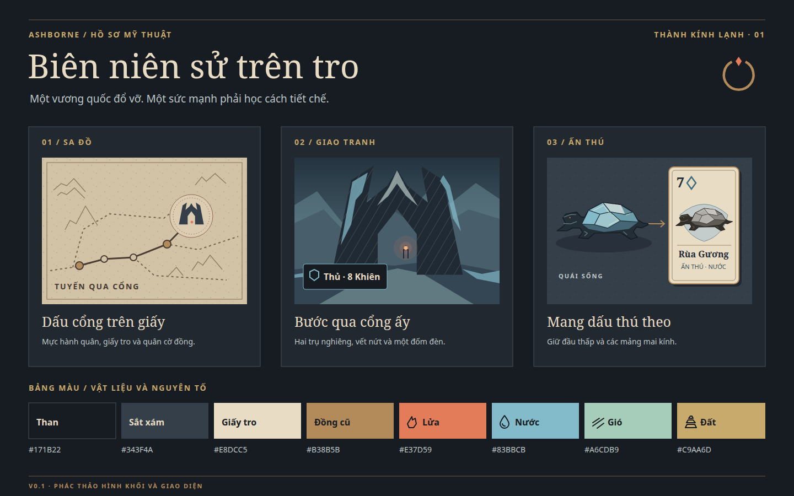

# Ashborne — Định hướng mỹ thuật v0.1

**Biên niên sử trên tro.** Dark fantasy 2D, với nét khắc trên giấy cháy sém phủ màu gouache. Thế giới có dấu vết của một nền văn minh từng biết dùng nguyên tố để sống, rồi dùng quá nhiều để thắng. Người chơi nhặt lại bản đồ, cờ và ấn của vương quốc ấy. Mỗi lần mở thành, họ phải quyết định sẽ đi xa đến đâu với chính sức mạnh từng hủy hoại nó.

Đây là hướng mỹ thuật để thử trên một màn chơi ngắn. Cơ chế tham chiếu từ [GDD/FDD](../../../Ashborne-GDD-va-FDD.md), [Chủng tộc và Binh chủng](../../../Ashborne-Chung-toc-va-Binh-chung.md) và [Thẻ combat](../../../Ashborne-Concept-The-Combat.md). Tên hướng mỹ thuật và các chi tiết tạo hình dưới đây là đề xuất.

[Bản vector của bảng phong cách](../Ashborne-Bang-Phong-Cach.svg) · [Brief minh họa Thành Kính Lạnh](../Thanh-Kinh-Lanh-ImageGen-Prompt.txt)

## 1. Một thế giới, ba cách nhìn

| Lớp | Người chơi thấy gì | Điều giữ chúng cùng một thế giới |
| --- | --- | --- |
| **Chiến dịch / Công thành** | Sa đồ nhìn từ trên xuống. Giấy xám ấm, mực đường hành quân, cờ đánh dấu quân và dấu ghim trên cổng thành. | Bóng dáng kiến trúc và biểu trưng địa phương được giản lược thành nét in. |
| **Giao tranh PvE** | Cảnh 2D nhìn chéo từ tầm người. Nhân vật, quái và đòn đánh có hình khối rõ; địa hình chìm về hai bên và sau vùng hành động. | Nhận ra đúng cổng thành trên sa đồ qua cùng hình dáng, vết nứt và vật liệu. |
| **Thư viện / Ấn Thú** | Sổ lưu mẫu, mỗi ấn là hình thú được ép thành bản khắc, có hạng và chất như bài tây. | Khi trao ấn, hình thân quái giữ nguyên tư thế chính rồi phẳng lại thành nét in. |

Hình hiệu đề xuất của Ashborne: **vòng ấn đứt ở đỉnh, một nét than còn hồng ở khe hở**. Ở cỡ nhỏ chỉ giữ vòng đứt và chấm than; lặp trên mặt lưng bài, niêm sáp và các cờ còn trung thành. Vòng khép có thể xuất hiện trên đồ vật từ trước đại chiến. Đây là biểu trưng của vương quốc, tách khỏi bốn chất của Ấn Thú.

Dấu hiệu của sự sống là vải vá, gỗ mới gác lên đá cũ và một đèn ấm ở nơi còn người. Dùng chúng ở trại, đoàn quân và thành vừa giải phóng để tạo cảm giác có thứ đáng giành lại. Chỗ sáng nhất của mỗi cảnh thuộc về mối đe dọa hoặc con đường người chơi cần nhìn.

## 2. Cách vẽ và dùng màu

- **Cảnh:** vẽ mảng sáng tối lớn trước; nét khắc để tả mép đá, nếp vải và vùng tối. Tiền cảnh gom mảng; trung cảnh dành tương phản cho nhân vật và đường vào; hậu cảnh giảm nét để tạo chiều sâu.
- **Nhân vật và quái:** dáng đọc được khi tô đen. Chi tiết tập trung quanh đầu, tư thế và phần cơ thể báo đòn. Với quái nhiễm nguyên tố, để nguyên tố biến đổi một phần hình thể: mai kết kính, vải kéo dài theo gió, tay nứt lộ than.
- **Vật liệu:** giấy sợi thô cho bản đồ, sắt xước cho chiến cụ, sáp ép cho ấn, đá có vết sửa cho kiến trúc. Dùng họa tiết ở rìa và vùng không có số liệu. Các bảng HUD dùng nền phẳng, mờ và đậm vừa đủ.
- **Chữ:** thử Noto Serif cho tên vùng và tiêu đề, Noto Sans cho số và luật bài. Kiểm dấu tiếng Việt ở cỡ thật, gồm chữ in hoa và tên dài. Chữ tiêu đề mang sắc thái cổ; số và mô tả ưu tiên đọc nhanh.

| Vai trò | Mẫu màu | Cách dùng |
| --- | --- | --- |
| Than / Sắt xám | `#171B22` / `#343F4A` | Nền tối và mặt bảng; từng vùng được phép nâng sáng riêng. |
| Giấy tro / Đồng cũ | `#E8DCC5` / `#B38B5B` | Giấy, chữ chính trên nền tối, chi tiết viền và dấu chọn. |
| Lửa · ♥ Cơ | `#E37D59` | Nét nhọn, than bật và tách nhánh; vệt bùng ngắn. |
| Nước · ♦ Rô | `#83BBCB` | Vòng gợn và dải cong; ở Frozen Cathedral, khối băng có mặt phẳng rạn. |
| Gió · ♠ Bích | `#A6CDB9` | Vệt xiên và đường thưa theo một hướng; nhìn rõ nhịp dịch chuyển. |
| Đất · ♣ Tép | `#C9AA6D` | Bậc đá, lớp trượt và khối hạ xuống; cảm giác nặng. |

Màu nguyên tố đi cùng glyph và tên. Chất bài tây dùng riêng trên Ấn Thú và thư viện, glyph nguyên tố dùng trên thẻ Nguyên tố, thanh tích và hiệu ứng gắn đòn. Dùng màu cảnh báo thống nhất với biểu tượng và nhãn của trạng thái, tách khỏi màu Lửa.

## 3. Bốn vùng, bốn hình dáng

| Vùng | Hình dáng nhận diện từ xa | Dấu vết người sống và nguyên tố |
| --- | --- | --- |
| **Ashlands** | Ống khói gãy, mái sập mở ra đường ngang thấp. | Tro xám và than đỏ trong khe; giàn gỗ mới bắc qua nền nhà cháy. |
| **Frozen Cathedral** | Hai trụ đá nghiêng vào một cổng nhọn rẽ đôi. | Kính băng thành từng tấm lớn, ánh trời bạc xanh; một đèn hổ phách báo có người ở gần. |
| **Storm Frontier** | Vách dốc quét xiên; dây và cờ cùng chỉ hướng. | Cột mốc và xe caravan buộc dây; mây và vải kể hướng gió trước khi thấy hiệu ứng. |
| **Stone Grave** | Mộ bia thấp và các bậc đá lớn như tường. | Đá vàng xỉn thành lớp, đường có dấu đục và tay vịn nhỏ để cho thấy tỉ lệ. |

Để giữ liên tục khi chuyển phase, mỗi thành có một **mẫu đối chiếu cổng**: một silhouette, một vết hư hại, một vật liệu và một mốc sáng. Vẽ chúng theo ba cỡ: ký hiệu trên bản đồ, ảnh xem trước, cảnh PvE. Khi giải phóng thành, thêm dấu sửa chữa hoặc ánh sáng vào địa điểm đã thấy.

## 4. Ngữ pháp thẻ

| Họ thẻ | Dấu hiệu nhìn nhanh | Nội dung hình |
| --- | --- | --- |
| **Chủng tộc** | Nhãn Chủng tộc, khung giấy hồ sơ và biểu tượng chủng. | Nửa thân hoặc toàn thân, tư thế trung tính, đủ thấy tỉ lệ cơ thể. |
| **Binh chủng** | Nhãn Binh chủng, phù hiệu vai trò, bậc viết rõ bằng số La Mã. | Trang bị đặc trưng, dáng đứng hoặc động tác mang vai trò. |
| **Quân đã ghép** | Phù hiệu vai trò + huy hiệu chủng + bậc trong cùng một cụm. | Dùng lại chân dung chủng làm ảnh nền. Phù hiệu và mô tả mang tin về vai trò; minh họa kết hợp chỉ làm riêng cho quân nổi bật. |
| **Vũ khí** | Tên và hình vũ khí, chi phí ở điểm cố định. | Một khoảnh khắc hành động. Ví dụ Giáo nhấn đường mũi thương và tầm với; Kiếm và Khiên phân rõ tay công và tay thủ. |
| **Nguyên tố** | Glyph lớn và tên hệ, phẩm nằm ở ô riêng. | Một vật hoặc vệt nguyên tố chuyển động theo riêng từng hệ. Phẩm cao tăng cấu trúc của hình và thêm dấu phẩm. |
| **Ấn Thú** | Hạng + chất ở góc; chữ «Ấn Thú» ở khay hoặc bản xem chi tiết. | Mảng khắc phẳng trên giấy ngà, giữ điểm nhận diện của quái sống. Joker Đen và Trắng giữ cùng cấu trúc, thay chất bằng dấu Joker và nhãn phân biệt. |

Tại cỡ tay bài thu nhỏ, giữ **biểu tượng, chi phí và tên rút gọn**; Ấn Thú ưu tiên hạng + chất. Khi chạm hoặc rê chuột, mở văn bản hoàn chỉnh. Vùng chồng có nhãn **«Lá đáy»** và bậc thứ tự; dùng một bảng kết quả để đọc điều sắp xảy ra. Trên sa đồ, thử chuỗi **Khiên binh → nâng bậc → ghép Cự nhân núi**, để kiểm tra người chơi nhìn ra bước nào thay đổi bậc và bước nào thay đổi chủng. Ở PvE, preview hiển thị lá chủ đạo, lá gắn và kết quả khi xác nhận. Các trạng thái chồng theo cấu hình luật; phần art không quyết định cách xử lý tổ hợp còn mở.

## 5. Bàn chơi, chuyển động và âm thanh

- **Sa đồ:** nút tuyến và cổng nằm trên giấy; quân chưa phân, lương và điểm công thành nằm trên bảng phẳng cạnh chồng. Dấu sáp đóng khi xác nhận ghép. Trước khi chốt, cờ và thẻ chỉ nằm ở trạng thái xem trước.
- **PvE:** vùng trên cho quái và ý đồ; vùng dưới cho tay bài và tài nguyên. Vùng thử chồng có chỗ cố định để không che mục tiêu hay ý đồ. Khay Ấn Thú có trạng thái «Đã dùng», đọc được cả khi mất màu. Giữ chữ, icon và số trên HUD thay vì khắc chúng vào nền cảnh.
- **Chờ quá tải:** vạch đầy và nhãn tĩnh bên thanh. **Quá tải:** một nhịp phủ viền mang hình của nguyên tố; giữ nguyên vị trí chữ và chi phí trên thẻ. Phản lực hiện bằng thay đổi HP và số trên HUD, kể cả khi tắt hiệu ứng.
- **Âm thanh:** giấy lướt khi xếp lá, tiếng sáp và gỗ khi ghép quân, kim loại hoặc tiếng vỡ kính khi xác nhận đòn, một âm khô giống giở trang khi thu ấn. Âm cảnh vùng nhỏ hơn âm báo ý đồ. Tùy chọn giảm rung, chớp và chuyển động mạnh giữ lại tín hiệu tĩnh.

## 6. Cảnh thử đầu tiên: Thành Kính Lạnh

1. **Sa đồ.** Cổng hai trụ nghiêng, khe vỡ ở đỉnh, một ký hiệu đèn. Trưng ba thẻ mẫu: Cự nhân núi, Khiên binh và quân ghép ở bậc có thể đọc ngay.
2. **Qua cổng.** Cắt theo dáng cổng từ nét mực sang đá và kính; cùng một đốm đèn giữ hướng nhìn. Có thể bỏ qua chuyển cảnh.
3. **Giao tranh.** Rùa Gương thân thấp, mảng mai lớn có mặt kính, đầu tối lộ rõ khi thò ra. Trạng thái thủ dùng tư thế rụt đầu và dựng mai; báo đòn dùng cách đặt chân và hướng đầu, kèm icon và số. Minh họa UI với một lá vũ khí, một lá Nước và một thẻ kết quả chồng.
4. **Thu phục.** Mai kính và đầu thấp giữ nguyên khi chuyển thành nét khắc của **7♦ Rùa Gương**. Dấu gợn vòng tượng trưng cho mốc sinh lực được lưu; mô tả lá vẫn thể hiện hiệu ứng hồi HP. Phân biệt hành vi thủ của quái khi sống và công dụng hồi sinh lực khi mở ấn.

**Bộ sản xuất thử:** một cảnh PvE chia lớp, một mảnh sa đồ, một bộ mẫu thẻ có đủ sáu họ, một Rùa Gương với dáng nghỉ/thủ/báo đòn và phiên bản khắc, bộ icon bốn hệ và các trạng thái chồng. Dùng bộ này để đo công sức trước khi minh họa cả kho chủng tộc và 54 ấn.

**Tiêu chí duyệt:** ở cỡ màn hình điện thoại mục tiêu, người xem nhận ra cùng một cổng ở hai phase và cùng một sinh vật trên lá 7♦; đọc được ý đồ, lá đáy và chi phí mà không cần phóng to; phân biệt được họ thẻ và Chờ quá tải khi chuyển sang thang xám. Nếu thông tin chìm, chỉnh chênh lệch sáng tối và mật độ chi tiết trước khi tăng kích thước hiệu ứng.
