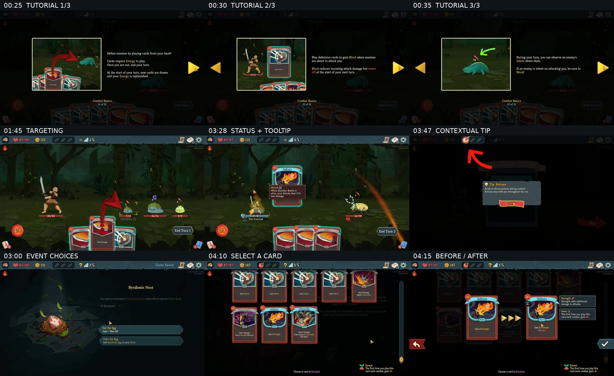

# Soi UI/UX và tutorial — Slay the Spire 2, 00:00–04:25

**Bản phân tích để duyệt · 18/11/2026 · Chưa phải quyết định thiết kế của Ashborne.**

Nguồn duy nhất cho các quan sát về game: [video Royal Gaming](https://www.youtube.com/watch?v=NhfIsNV_Oew). Phạm vi tính từ đầu video, không tính từ tham số 00:37 trong link gửi. Đã đối chiếu 266 khung hình gốc 1920×1080 theo từng giây từ 00:00 đến 04:25 và soi thêm các đoạn trọng tâm ở mật độ 4 khung/giây. Đây là rà hình theo thời gian và trạng thái, không phải tuyên bố đã kiểm riêng toàn bộ khoảng 15.900 frame của video 60 fps. Các mốc dưới đây là mốc đối chiếu hình ảnh, không phải thời điểm chính xác đến từng frame bắt đầu/kết thúc một animation. Đánh giá hiệu quả học là nhận định thiết kế; một video gameplay không thay thế được thử nghiệm với người chơi mới.

[Bộ ảnh đối chứng theo thời gian](BO-ANH-DOI-CHIEU.md) gồm bảng ảnh từng giây, các đoạn soi chi tiết và ảnh gốc để phóng đọc.

## 1. Kết luận đáng duyệt trước

Điểm mạnh nhất là **mỗi loại thông tin có một chỗ cố định, và mỗi thao tác để lại dấu vết có thể đọc lại**. Người chơi nhìn intent ở trên đầu địch, HP và trạng thái ngay dưới chủ thể, bài ở dưới giữa, năng lượng ở dưới trái, kết lượt ở dưới phải. Khi ra bài, animation cho biết chuyện vừa xảy ra; sau animation, số và icon cho biết chuyện đó còn hiệu lực ra sao.

Tutorial có hai tầng. Tầng đầu là ba trang hướng dẫn: dùng bài và năng lượng → Block → intent. Tầng tiếp theo là các lời nhắc theo ngữ cảnh: chọn phòng trên bản đồ; xáo bài khi chồng rút cạn; giải thích Power khi gặp lá Power; chỉ ô potion khi lần đầu nhận potion. Tooltip tiếp tục giải thích từ khóa lúc rê chuột. Nhờ vậy, game không cần đặt toàn bộ luật vào một màn hướng dẫn đầu tiên.

**Điểm chưa đủ để kết luận “hiểu sau một lần tut”:** ba trang đầu chủ yếu cho đọc và bấm tiếp, chưa thấy yêu cầu người chơi thực hiện đúng từng kỹ năng rồi mới đi tiếp. Người quay thao tác nhanh và chủ động đọc tooltip; không biết họ đã từng chơi hay chưa. Vì vậy, nên học cách tổ chức thông tin, đồng thời bổ sung bước kiểm chứng hiểu nếu mục tiêu của Ashborne là người mới tự chơi được sau một lần hướng dẫn.

Sáu đề xuất trình duyệt:

1. Giữ cấu trúc combat ba tầng: tài nguyên chuyến đi ở trên; chủ thể và tình huống ở giữa; thao tác ở dưới.
2. Mỗi nhân vật có cụm riêng: intent trên đầu; HP/Khiên sát chân; buff/debuff dưới HP.
3. Mỗi thay đổi quan trọng phải có cả phản hồi tức thời và dấu hiệu tồn tại sau đó.
4. Dạy một quyết định nhỏ mỗi bước, cho làm ngay và kiểm tra kết quả.
5. Tra cứu từ khóa tại chỗ; giải thích cơ chế mới khi lần đầu thực sự cần dùng.
6. Các lựa chọn thay đổi bài phải cho xem kết quả trước/sau rồi mới xác nhận.

## 2. Nhật ký quan sát theo thời gian

| Mốc đối chiếu | Điều nhìn thấy | Ý nghĩa UI/UX |
| --- | --- | --- |
| [00:00](https://www.youtube.com/watch?v=NhfIsNV_Oew&t=0s) | Logo lớn, menu Singleplayer/Multiplayer/Settings/Quit thành một cụm; hồ sơ ở trên trái. | Một nhóm hành động chính, không rải nút khắp nền minh họa. |
| [00:05–00:07](https://www.youtube.com/watch?v=NhfIsNV_Oew&t=5s) | Chọn Ironclad, hộp hỏi bật tutorial nằm giữa; nền bị làm tối; Yes xanh, No đỏ. | Tách quyết định bật hướng dẫn khỏi thông tin nhân vật; xác lập điểm nhìn chính. |
| [00:15](https://www.youtube.com/watch?v=NhfIsNV_Oew&t=15s) | Bản đồ giấy, tên Act 1 / Overgrowth phủ giữa; bảng Legend bên phải, HUD giữ ở trên. | Báo chương mới và cho đọc tuyến đường bằng ký hiệu. |
| [00:17–00:18](https://www.youtube.com/watch?v=NhfIsNV_Oew&t=17s) | Hộp nhắc chọn phòng, mũi tên chỉ nút đầu trên bản đồ. | Dạy di chuyển tại đúng đối tượng cần bấm. |
| [00:25](https://www.youtube.com/watch?v=NhfIsNV_Oew&t=25s) | Combat Basics 1/3: hình minh họa bên trái, nội dung bên phải, nút tiếp sang phải. Hình dùng lá tấn công và mũi tên chỉ địch. | Dạy mục tiêu, hành động, giới hạn năng lượng và việc rút bài/hồi năng lượng đầu lượt trong cùng một ngữ cảnh. |
| [00:30](https://www.youtube.com/watch?v=NhfIsNV_Oew&t=30s) | Trang 2/3: lá Defend và nhân vật, từ khóa Block nổi bật; giải thích Block giảm sát thương và hết ở đầu lượt tiếp theo. | Dạy phòng thủ cùng thời hạn, tránh hiểu Khiên là tài nguyên tích lũy vĩnh viễn. |
| [00:35](https://www.youtube.com/watch?v=NhfIsNV_Oew&t=35s) | Trang 3/3: hình quái với kiếm và số 14 trên đầu, mũi tên xanh chỉ đúng icon. | Đưa khái niệm intent về một vị trí có thể nhận ra ngay trên sân. |
| [00:40](https://www.youtube.com/watch?v=NhfIsNV_Oew&t=40s) | Đã có 15 Block, HP 80/80, năng lượng 0/3; End Turn 1 sáng viền; hai Strike còn trên tay. | Hết năng lượng không đồng nghĩa hết bài; Khiên và HP có thể cùng đọc được. |
| [00:45](https://www.youtube.com/watch?v=NhfIsNV_Oew&t=45s) | Sang lượt 2; rê Bash làm lá phóng lớn; tooltip Vulnerable nằm sát lá. Intent địch có cả kiếm và khiên. | Tra luật ngay khi cân nhắc bài; intent mô tả được hành động kết hợp. |
| [00:50](https://www.youtube.com/watch?v=NhfIsNV_Oew&t=50s) | Bash gây số nổi 8, chữ Vulnerable hiện trên địch; icon đỏ kèm số xuất hiện dưới HP. Tooltip kết lượt mô tả bỏ tay bài, địch hành động và rút tay mới. | Một cơ chế được thể hiện bằng lá bài, sự kiện tức thời, trạng thái tồn tại và lời giải thích. |
| [00:55](https://www.youtube.com/watch?v=NhfIsNV_Oew&t=55s) | Hộp nhắc khi không còn bài để rút; hai mũi tên đỏ chỉ chồng bỏ bên phải và chồng rút bên trái. | Giải thích xáo lại bài ngay khi nó xảy ra, dựa vào vị trí thật trên màn hình. |
| [01:00–01:15](https://www.youtube.com/watch?v=NhfIsNV_Oew&t=60s) | Lặp nhiều lượt, đổi Player Turn/Enemy Turn, số lượt tăng; Khiên, intent, debuff cập nhật; bài bay giữa các vùng. | Củng cố luật bằng cùng một bố cục, không mở một loại giao diện mới mỗi lượt. |
| [01:20](https://www.youtube.com/watch?v=NhfIsNV_Oew&t=80s) | Địch gục, có số hồi xanh 6 và dấu cộng trên người chơi, HP trở về 80/80. | Phân biệt kết quả chết của địch và hồi phục của người chơi bằng vị trí, màu, hình. Số hiệu ứng hồi không đồng nghĩa toàn bộ lượng đó đã cộng vào HP nếu chạm trần. |
| [01:25–01:30](https://www.youtube.com/watch?v=NhfIsNV_Oew&t=85s) | Chọn một trong ba lá; rê lá làm to và mở tooltip Block hoặc Strength; có Skip. | Cho so sánh ít lựa chọn, giữ lại quyền bỏ qua và đọc từ khóa tại chỗ. |
| [01:35](https://www.youtube.com/watch?v=NhfIsNV_Oew&t=95s) | Trở lại bản đồ; nút đã đi được khoanh, mũi chỉ vị trí; các đường nối thể hiện nhánh. | Người chơi hiểu mình ở đâu và bước tiếp theo thuộc tuyến nào. |
| [01:40–01:45](https://www.youtube.com/watch?v=NhfIsNV_Oew&t=100s) | Trận mới có ba địch, từng con có HP và intent riêng; chọn Strike tạo đường ngắm đỏ và bốn góc vàng quanh mục tiêu. | Từ một địch chuyển sang nhiều địch bằng cách nhân bản cùng một cấu trúc thông tin. |
| [01:50](https://www.youtube.com/watch?v=NhfIsNV_Oew&t=110s) | Địch đưa hai lá Slimed lên màn hình, đồng thời có phản hồi trên người chơi. | Báo hậu quả ảnh hưởng bộ bài bằng chính hình dạng lá bài, thay vì chỉ dùng một icon khó đoán. |
| [02:00–02:05](https://www.youtube.com/watch?v=NhfIsNV_Oew&t=120s) | Setup Strike được chọn; sau đó chữ báo Strength hết hiệu lực xuất hiện trên người chơi khi chuyển lượt. | Hết hiệu lực cũng là một sự kiện cần báo; không để icon biến mất một cách vô cớ. |
| [02:15](https://www.youtube.com/watch?v=NhfIsNV_Oew&t=135s) | Strike đang ngắm hiển thị 8 damage; người chơi có icon Strength kèm số dưới HP. | Giá trị trên lá có thể phản ánh trạng thái hiện tại, giúp tính toán ngay lúc chọn. |
| [02:20–02:35](https://www.youtube.com/watch?v=NhfIsNV_Oew&t=140s) | Slimed xuất hiện lớn khi bị thêm và xuất hiện trên tay; có thể đọc loại Status, phí 1, hiệu ứng rút bài và Exhaust. | Trạng thái làm bẩn bộ bài được chuyển thành một vật thể có thể xem và xử lý trong hệ thống bài. |
| [02:45–02:55](https://www.youtube.com/watch?v=NhfIsNV_Oew&t=165s) | Kết trận, vào chọn bài; hộp Tip: Power Cards làm nổi lá Inflame, giải thích buff kéo dài trong một combat. | Cơ chế loại bài được dạy khi người chơi đang có lý do cân nhắc nó. |
| [03:00–03:05](https://www.youtube.com/watch?v=NhfIsNV_Oew&t=180s) | Sự kiện Byrdonis Nest: tranh bên trái, nội dung và hai nút bên phải; từng nút có tên hành động và kết quả. | Chuyển từ đọc chuyện sang chọn có hệ quả rõ ràng, không bắt người chơi tự suy diễn từ tên nút. |
| [03:10](https://www.youtube.com/watch?v=NhfIsNV_Oew&t=190s) | HUD cho thấy 87/87 sau lựa chọn tăng 7 Max HP; quay lại bản đồ. | Kết quả lựa chọn được phản ánh ở dữ liệu thường trực. |
| [03:15–03:25](https://www.youtube.com/watch?v=NhfIsNV_Oew&t=195s) | Trận Shrinker Beetle; người chơi bị thu nhỏ rõ rệt, có icon xanh dưới HP; Strike đang xem chỉ còn 4 damage. | Một bất lợi được thể hiện trực tiếp lên hình thể và giá trị bài. Ở 03:28 tooltip Shrink giải thích: khi Shrinker Beetle còn sống, Attack của người chơi giảm 30% sát thương. |
| [03:30–03:40](https://www.youtube.com/watch?v=NhfIsNV_Oew&t=210s) | Người chơi vẫn nhỏ; thấy thêm icon Strength, Strike gây 8; HP và intent địch tiếp tục cập nhật. | Nhiều trạng thái cùng tồn tại mà vị trí thông tin không đổi; số trên lá/hit cho phép kiểm tra tác động tổng hợp. |
| [03:47](https://www.youtube.com/watch?v=NhfIsNV_Oew&t=227s) | Tip: Potions trỏ vào ô potion mới; giải thích uống/ném trong combat và giữ xuyên hành trình. | Dạy vị trí, cách dùng và thời gian lưu giữ ngay sau khi nhận. |
| [03:45–03:50](https://www.youtube.com/watch?v=NhfIsNV_Oew&t=225s) | Loot có vàng, Fire Potion, thêm bài; sau nhận potion, một ô potion ở HUD được lấp; ba lá thưởng và Skip. | Phần thưởng có chỗ đến cụ thể trong HUD/bộ bài, không chỉ là một thông báo nhận thưởng. |
| [04:00–04:05](https://www.youtube.com/watch?v=NhfIsNV_Oew&t=240s) | Sự kiện Sapphire Seed: một nhánh hồi 9 HP và nâng bài; nhánh khác Enchant với Sown, có tooltip. | Đặt lợi ích trước lựa chọn, đưa giải thích từ khóa cạnh lựa chọn. |
| [04:10](https://www.youtube.com/watch?v=NhfIsNV_Oew&t=250s) | Danh sách bài dạng lưới, cuộn bên phải, nhắc chọn bài để Enchant. | Chuyển sang một nhiệm vụ đơn: chọn đối tượng chịu thay đổi. |
| [04:15](https://www.youtube.com/watch?v=NhfIsNV_Oew&t=255s) | So sánh Inflame cũ bên trái và bản Sown bên phải, mũi tên ở giữa; nút quay lại trái và dấu xác nhận phải; tooltip xếp cạnh. | Cho kiểm tra thay đổi trước khi cam kết, không bắt ghi nhớ lá gốc. |
| [04:20–04:25](https://www.youtube.com/watch?v=NhfIsNV_Oew&t=260s) | Lá đã gắn Sown được trình bày lại trên nền sự kiện rồi chuyển cảnh. | Đóng vòng thao tác bằng việc cho thấy kết quả cuối. |

## 3. Bóc tách bố cục combat

### 3.1. Ba tầng thông tin

**Tầng trên — thông tin xuyên màn.** Từ trái sang phải: nhận diện nhân vật, HP, vàng, ô potion, tiến độ tầng; phía phải là các tiện ích như bản đồ, bộ bài, cài đặt. Di vật nằm thành cụm dưới mép trên bên trái. Thanh này xuất hiện qua combat, bản đồ và sự kiện, tạo một trục tham chiếu liên tục.

**Tầng giữa — chủ thể và tình huống.** Người chơi đứng bên trái, địch bên phải. Khoảng trống giữa hai bên dành cho bài đang được dùng, số sát thương và thông báo lượt. Phần nền có nhiều chi tiết nhưng tối và ít tương phản hơn cụm bài, số, đường chọn mục tiêu. Intent nằm phía trên địch; HP nằm dưới hình thể; buff/debuff dưới HP.

**Tầng dưới — nơi hành động.** Năng lượng ở dưới trái; chồng rút ở góc trái; tay bài xòe ở giữa; chồng bỏ ở góc phải; End Turn đặt phía phải trên chồng bỏ. Tay bài gần người chơi và cùng một mặt phẳng thao tác. Không phải đi lên HUD để thực hiện từng hành động chiến đấu.

Nhịp nhìn có thể hình dung: **intent → bài → năng lượng/chi phí → mục tiêu → kết quả HP/Khiên → kết lượt**. Đây là diễn giải từ vị trí thông tin, không phải dữ liệu đo mắt người chơi.

### 3.2. Vì sao HP hiện hai nơi vẫn có ích

HP ở HUD giúp theo dõi sức khỏe xuyên chuyến đi và vẫn đọc được khi sân bị một màn lựa chọn che. HP ngay dưới người chơi giúp đối chiếu trực tiếp với Khiên, buff và hit vừa nhận. Hai vị trí phục vụ hai mức đọc khác nhau. Nếu dùng cho Ashborne, số liệu hai chỗ phải cập nhật cùng lúc; tránh HUD báo một giá trị còn thanh sát nhân vật báo giá trị khác.

### 3.3. Thông tin gần đối tượng sở hữu nó

| Câu người chơi cần trả lời | Nơi video đặt câu trả lời | Tác dụng |
| --- | --- | --- |
| Con nào sắp đánh, đánh bao nhiêu? | Kiếm và số trên từng địch. | Không phải ghép danh sách intent bên ngoài với nhân vật trong sân. |
| Con nào đang bị Vulnerable? | Icon và số ngay dưới HP của con đó. | Giảm nhầm chủ thể khi có nhiều địch. |
| Tôi còn bao nhiêu Khiên? | Huy hiệu khiên và số sát thanh HP; có phản hồi hình khiên trên người khi nhận Block. | Phân biệt lượng phòng thủ tồn tại với animation cấp phòng thủ. |
| Lá này tốn bao nhiêu? | Huy hiệu số ở góc trên trái lá. | Đọc chi phí trước khi đọc hết mô tả. |
| Tôi đang chọn con nào? | Mũi tên ngắm + góc vàng + tên xuất hiện sát mục tiêu. | Có nhiều tín hiệu xác nhận cùng một đối tượng. |
| Từ khóa này nghĩa gì? | Tooltip cạnh lá hoặc lựa chọn đang rê. | Giữ ngữ cảnh, không cần mở sách luật. |

### 3.4. Quy mô và khoảng trống

Ở trận một địch, game để sân khá thoáng. Sang ba địch, từng con vẫn có không gian cho intent và HP riêng. Đây là bài học về **dự trù kích thước cụm thông tin cho tình huống đông nhất**, không phải chỉ căn đẹp ở trận một con. Bài phóng lớn có thể che một phần sân; tooltip còn chiếm thêm chiều ngang. Khi áp dụng, phải thử đồng thời: lá lớn + tooltip dài + nhiều địch + nhiều icon, không kiểm tra từng lớp riêng lẻ.

Các tỷ lệ pixel trong ảnh video chỉ nên dùng làm tham chiếu thị giác. Không suy ra kích thước nút thật, vùng bắt chuột hoặc quy tắc responsive của game từ một bản quay.

### 3.5. Chữ, màu và vật liệu giao diện

Tên game, chương, tiêu đề và các thông báo lượt dùng chữ có chân với dáng lớn, hợp chất fantasy. Nội dung hướng dẫn và tooltip nhỏ hơn, đặt trên nền tối hoặc xanh xám tương đối phẳng. Lá bài có khung đỏ nâu; vùng hình ở trên, loại bài thành nhãn ở giữa, mô tả cơ chế bên dưới. Chi phí nằm trong huy hiệu góc trái để không lẫn với lượng damage/Block trong thân lá.

Nền rừng xanh tối tạo khoảng tương phản cho vàng của tiêu đề, trắng của số/chữ, đỏ của tấn công và xanh của Khiên. Bản đồ chuyển sang giấy vàng sáng, nhưng HUD vẫn giữ chất đá xanh xám. Nút và panel có viền, đầu cắt hoặc mép giấy thay cho các hình chữ nhật phẳng; cách xử lý này duy trì cùng một thế giới mỹ thuật qua nhiều loại màn.

Màu còn phân cấp chữ trong một dòng: từ khóa cơ chế được nhấn, cảnh báo mất hiệu lực có sắc đỏ, tên hành động và lợi ích quan trọng được làm nổi. Không nên suy ra toàn bộ bảng độ hiếm từ màu viền các lá trong một đoạn ngắn. Với Ashborne, điều cần giữ là độ đọc rõ, thứ bậc và tính nhất quán; vật liệu cụ thể phải theo hướng mỹ thuật đã chốt của game mình.

### 3.6. Màn chọn nhân vật và giới hạn lựa chọn ban đầu

Ở 00:03–00:04, phần trái gom tên Ironclad, HP 80/80, vàng 99, mô tả nhân vật và di vật khởi đầu; tranh lớn nằm bên phải. Hàng chân dung ở dưới có lựa chọn đang mở và các ô khóa. Quay lại nằm bên trái, xác nhận nằm bên phải. Màn này giới thiệu đặc tính khởi đầu mà chưa yêu cầu người chơi tự cấu hình một bộ bài phức tạp. Đây là một cách hạn chế tải lựa chọn ban đầu; chưa thể suy ra từ ảnh điều kiện mở khóa các nhân vật còn lại.

## 4. Flow tutorial và cơ chế ghi nhớ

### 4.1. Chuỗi dạy thực tế

**Hỏi bật hướng dẫn → nhắc chọn phòng → ba trang cơ bản → trận một địch → nhắc xáo bài → thưởng chọn bài → trận nhiều địch → nhắc Power → sự kiện → nhắc potion lúc nhận → sự kiện và thay đổi bộ bài.**

Không nên coi cả 4:25 là một tutorial khóa cứng. Trong đoạn này có hướng dẫn chủ động, tooltip tùy nhu cầu và gameplay tự do đan xen. Trình tự người quay gặp các màn không đủ chứng minh mọi người chơi đều gặp đúng chuỗi địch/phần thưởng/sự kiện này.

### 4.2. Ba trang đầu làm gì tốt, còn thiếu gì

| Trang | Luật được đưa vào | Cách thể hiện | Điểm mạnh | Khoảng trống |
| --- | --- | --- | --- | --- |
| 1/3 | Dùng bài để thắng; cần Energy; hết thì kết lượt; đầu lượt rút bài/hồi Energy. | Ảnh bài, đường ngắm, địch + văn bản ngắn bên cạnh. | Liên kết hành động, tài nguyên và vòng lượt trong cùng hình. | Có khá nhiều ý trong một trang; không thấy phải tự đánh một lá để qua. |
| 2/3 | Bài phòng thủ cấp Block; Block giảm sát thương; mất đầu lượt sau. | Hình Defend, người chơi, từ khóa nhấn màu. | Nhắc thời hạn ngay lần đầu, tránh hình thành luật sai. | Chưa thấy bài tập tự dự tính HP mất sau Khiên. |
| 3/3 | Intent ở trên địch; địch sắp đánh thì cân nhắc Block. | Mũi tên chỉ kiếm và số trên quái. | Cho biết nhìn ở đâu và dùng thông tin đó để làm gì. | Thứ tự dạy intent sau Block khiến lý do dùng phòng thủ đến hơi muộn. |

Số trang “1 of 3” tạo cảm giác phần đọc có điểm kết thúc. Nút trước/sau cho phép xem lại ngay trong cụm hướng dẫn. Nền sân vẫn hiện qua lớp tối nên hướng dẫn gắn với bối cảnh đang chơi. Tuy vậy, ảnh minh họa là một hình giải thích riêng; không được coi mũi tên trong hình là thao tác người chơi đã tự thực hiện.

### 4.3. Dạy đúng lúc cần

Lời nhắc xáo bài đáng học nhất ở **mối quan hệ giữa điều kiện và vị trí**. Chồng rút cạn là lúc người mới có thể nghĩ “mình hết bài rồi”; hộp nhắc trả lời đúng hiểu lầm đó, đồng thời trỏ vào hai chồng thật. Cơ chế được gắn vào một sự kiện có thể nhớ.

Nhắc Power đặt tại màn chọn lá Inflame: người chơi đang cân nhắc thêm lá đó vào bộ bài, nên việc giải thích thời gian hiệu lực có ích ngay. Tuy nhiên, hiểu Power lúc chọn thưởng chưa đảm bảo hiểu nó khi dùng trong trận. Cần thêm dấu tồn tại sau khi chơi lá, và sự rõ ràng khi hiệu lực kết thúc.

Tooltip bổ sung tầng thứ ba: người đã hiểu có thể bỏ qua, người chưa hiểu có thể dừng để đọc. Trong video thấy các giải thích Block, Vulnerable, Strength, Sown và kết lượt. Còn có tooltip Exhaust khi rê Slimed, Unplayable khi xem lá trứng tại sự kiện và Shrink khi xem trạng thái trên người chơi. Có thể tra từ khóa trong nhiều ngữ cảnh khác nhau, thay vì học một từ chỉ tại một màn duy nhất.

Lần soi chi tiết còn thấy người quay rê trực tiếp vào intent ở khoảng 00:37, mở một tooltip giải thích địch định đánh 12. Như vậy hướng dẫn chỉ vị trí icon xong, ngay tại icon vẫn có lớp giải thích bằng chữ. Đây là kết nối hữu ích giữa “đã được giới thiệu” và “có thể tự tra lại”.

### 4.4. “Một lần tut” cần được định nghĩa bằng hành vi

Không dùng “đã bấm Got it” làm bằng chứng đã hiểu. Với combat bài cơ bản, người chơi cần tự làm được ít nhất:

1. Chỉ đúng địch đang sắp tấn công và đọc số sát thương.
2. Chọn bài vừa đủ tài nguyên, xác định đúng mục tiêu.
3. Nói được vì sao HP bị trừ hoặc không bị trừ sau Khiên.
4. Kết lượt và dự đoán tay bài/năng lượng thay đổi thế nào.
5. Tra được một buff/debuff không quen và đọc thời hạn của nó.
6. Hiểu rằng chồng rút cạn sẽ được bổ sung từ chồng bỏ theo luật đang dùng.

Đây là tiêu chí đề xuất, chưa được video kiểm nghiệm. Đối với Ashborne còn phải bổ sung kỹ năng riêng của chồng bài/cửa sổ thi triển; không thể lấy bộ tiêu chí của Slay the Spire làm toàn bộ tutorial cho game mình.

## 5. Ngữ pháp thể hiện trạng thái nhân vật

### 5.1. Tách bốn loại thông tin

- **Trạng thái hiện tại:** HP, Khiên, buff/debuff và các số đếm.
- **Hành động sắp xảy ra:** intent phía trên địch.
- **Sự kiện vừa xảy ra:** số damage/hồi nổi, chữ trạng thái, hit flash, tư thế tấn công.
- **Quyền hành động của lượt:** Player Turn/Enemy Turn, số lượt, năng lượng và End Turn.

Không gộp bốn loại này thành một hàng icon. “Địch sẽ tăng sức mạnh” và “địch hiện đã có Strength” là hai thông tin khác nhau dù đều liên quan sức mạnh. Trong video, vị trí trên đầu và dưới HP giúp phân vai.

### 5.2. Bảng trạng thái đã thấy

| Trạng thái/sự kiện | Dấu hiệu tức thời | Dấu hiệu đọc lại | Điều cần học cho Ashborne |
| --- | --- | --- | --- |
| Bình thường | Tư thế chờ. | HP hiện tại/tối đa và thanh. | Dữ liệu nền luôn có chỗ cố định. |
| Được cấp Block | Hình khiên xanh phủ lên người khi dùng Defend. | Khiên có số sát HP; thanh HP có lớp hiển thị xanh trong trạng thái này. | Có cả khoảnh khắc cấp và lượng Khiên còn lại; không để màu xanh khiến người chơi nhầm HP đã hồi. |
| Đánh trúng | Nhân vật vung kiếm/địch phản ứng, số sát thương nổi sát địch. | HP giảm. | Sự kiện và dữ liệu cuối phải khớp; ưu tiên đọc được mục tiêu chịu tác động. |
| Bị tấn công qua Khiên | Khiên và hit tham gia chuỗi xử lý. | Ví dụ HP 80→79 sau lượt địch có 6 damage và người chơi có 5 Block. | Nên có khả năng giải thích phần bị chặn và phần vào HP; chưa thấy đủ căn cứ nói video luôn tách thành hai con số. |
| Vulnerable | Chữ trạng thái đỏ nổi gần địch khi Bash áp dụng. | Icon đỏ kèm số dưới HP; tooltip từ lá giải thích hiệu ứng. | Có thông báo Vulnerable hết hiệu lực ở 03:33–03:34. Không dựa vào chữ nổi vì chữ sẽ biến mất. Số icon cần làm rõ là thời hạn hay số tầng. |
| Strength tạm thời | Tên hiệu ứng và phản hồi trên người chơi. | Icon kiếm kèm số; giá trị lá tấn công thay đổi. | Hiệu ứng phải phản ánh lên hành động mà nó sửa đổi. |
| Hết Strength tạm thời | Có chữ báo hết hiệu lực tại chuyển lượt. | Icon/giá trị liên quan cập nhật. | Hết hiệu lực cũng cần đọc được nguyên nhân. |
| Bị thêm Slimed | Hiện lớn hai lá trạng thái, phản hồi xanh trên người chơi. | Lá Status nằm trong vòng rút/tay bài về sau. | Phân biệt trạng thái gắn vào cơ thể với thay đổi bộ bài; không biểu diễn tất cả bằng icon buff. |
| Bị thu nhỏ | Hình người chơi thu nhỏ hẳn ở trận Beetle. | Kích thước vẫn nhỏ, icon xanh còn dưới HP, giá trị bài giảm ở mốc kiểm tra. | Tooltip 03:28 gọi tên Shrink, giải thích giảm 30% damage Attack khi Beetle còn sống. Ở 03:43 Beetle chết, có báo Shrink hết và hình người trở lại bình thường. Vòng đời trạng thái gắn với nguồn gây được thể hiện đầy đủ. |
| Hồi phục | Số xanh, dấu cộng, hiệu ứng trên người chơi. | HP HUD và HP sát người cùng tăng về trần. | Phân biệt hồi thực nhận và lượng hiệu ứng tối đa nếu cần tính chính xác. |
| Địch chết | Địch gục/bẹt; chữ Dead hiện khi hạ Leaf Slime ở 01:47, rồi cụm HP biến mất. | Chuyển sang phần thưởng khi hết địch. | Không giữ hình thái chọn mục tiêu hợp lệ trên địch đã chết. |

### 5.3. Vòng đời đầy đủ của một trạng thái

Một trạng thái dễ hiểu cần trả lời được sáu câu: **ai gây → ai nhận → đổi điều gì → bao nhiêu → còn bao lâu → lúc nào kết thúc**. Video trả lời bằng nhiều lớp: nguồn là lá bài; người nhận là đường ngắm; thay đổi là chữ/icon; lượng là số; kết thúc có phản hồi tại chuyển lượt.

Điểm cần bổ sung khi thiết kế mới: phân biệt **số tầng**, **số lượt**, **số lần kích hoạt** bằng ngôn ngữ rõ ràng trong tooltip. Không thể khẳng định một con số nhỏ cạnh icon đã tự giải thích được cả ba ý đó. Với nhiều trạng thái, cần quy tắc ưu tiên và mở danh sách đầy đủ; đoạn video chưa kiểm tra được trường hợp icon quá đông.

## 6. Tương tác với bài và phản hồi thao tác

### 6.1. Lá bài có nhiều mức biểu diễn

Ở trạng thái nghỉ, tay bài xòe để lộ tên/phí và một phần hình. Khi rê, một lá được nâng lên và phóng lớn; outline xanh làm nó tách khỏi nền. Khi ngắm ra khoảng trống, đường ngắm xám; khi trỏ đúng địch, đường chuyển đỏ và mục tiêu có dấu góc vàng (01:43–01:46). Khi thi triển, lá xuất hiện nổi bật trên sân rồi có chuyển động về chồng bài.

Các mức này trả lời liên tiếp: **tôi có gì → đang đọc lá nào → đang dùng lên ai → lá nào vừa gây hiệu ứng → sau dùng lá đi đâu**. Đây là một chuỗi nhận diện nhất quán, có ích hơn việc làm mỗi bước bằng một loại popup khác nhau.

Outline xanh còn xuất hiện trên nhiều lá có thể dùng và trên nút End Turn ở những thời điểm khác nhau. Không nên áp dụng một màu tương tác cho tất cả mà bỏ khác biệt về hình dạng, kích thước và vị trí. Khi triển khai Ashborne, cần tách rõ hover, đang chọn, có thể dùng, thiếu mana và bị khóa. Video không cho thử đầy đủ các trạng thái lỗi này.

### 6.2. Phản hồi số và phản hồi chuyển động

Ví dụ Bash: đọc phí và hiệu ứng trên lá → dùng vào địch → thấy damage 8 → HP địch đổi 45→37 → chữ Vulnerable hiện → icon Vulnerable còn lại dưới HP. Mỗi lớp có vai trò riêng. Người đang nhìn sân thấy hit; người đọc lại sau hit thấy HP và icon; người chưa biết luật có tooltip.

Animation luân chuyển bài nối các vùng ở đáy màn hình, giúp giải thích chồng rút/chồng bỏ. Dùng Slimed ở 02:35 làm xuất hiện bộ đếm tím riêng phía trên chồng bỏ. Tooltip Exhaust ở 02:40 giải thích loại khỏi phần còn lại của combat. Bài dùng thông thường và bài bị loại có dấu theo dõi khác nhau, không nên gộp thành một chồng. Nhưng đường sáng khá lớn, đôi lúc cắt ngang sân và đi gần intent/HP. Đây vừa là phản hồi hữu ích vừa là nguy cơ che thông tin. Nên giảm cường độ cho thao tác lặp nhiều lần, giữ dữ liệu chiến thuật nằm trên hiệu ứng khi cần và có tùy chọn giảm chuyển động.

### 6.3. Không suy ra những thứ video không chứng minh

Không thể xác nhận từ bản quay: click hay kéo là cơ chế duy nhất; cách hủy mục tiêu; vùng bắt chuột thật; phản ứng khi thả sai; thứ tự xử lý input trong lúc animation; hỗ trợ bàn phím/tay cầm; có cho xem lại tut sau trận hay không. Tooltip kết lượt có gợi phím E, nhưng đoạn này không chứng minh người quay đã dùng phím đó.

### 6.4. Hai chuỗi nhỏ cho thấy cách game truyền đạt kết quả

**Phòng thủ lượt đầu:** tại khoảng 00:38–00:40, ba lần Defend làm năng lượng giảm 3→2→1→0 và Khiên tăng 5→10→15, trong khi intent địch là 12. Khi bị đánh ở khoảng 00:42 có chữ báo chặn, HP vẫn 80/80, Khiên còn 3; sang đầu lượt mới phần Khiên còn lại bị xóa và năng lượng được nạp. Chuỗi này dạy được cả cộng dồn, hấp thụ và hết hạn. Đồng thời nó cho thấy người chơi có thể dùng dư phòng thủ; không thấy hướng dẫn ngăn hoặc giải thích việc dư đó.

**Phòng thủ thiếu ở lượt kế:** người chơi có 5 Block và địch định đánh 6. Sau lượt địch, HP còn 79/80, số 1 nổi trên người chơi. Đây là đối chứng tốt với lượt trước: cùng một cụm UI cho thấy khác biệt giữa chặn hết và còn sát thương lọt qua. Khi xây tutorial thực hành cho Ashborne, có thể dùng hai tình huống tương phản như vậy để kiểm tra hiểu, với số và luật Khiên đã được dự án chốt.

Một điểm cần thử kỹ khi làm giao diện mới: ở khoảng 00:40–00:41, banner Player Turn đang rời màn trong lúc Enemy Turn xuất hiện, hai chữ có lúc chồng lên nhau. Đây là điều nhìn thấy trong bản quay, chưa đủ kết luận nguyên nhân kỹ thuật. Nên ưu tiên làm rõ quyền hành động hiện tại và tránh chuyển cảnh chữ làm người mới phân vân đang là lượt ai.

## 7. UI ngoài trận vẫn tham gia dạy luật

### 7.1. Thưởng và xây bộ bài

Màn chọn thưởng đưa ra ba lá có khoảng cách rõ, một tiêu đề nhiệm vụ và một nút Skip. Người chơi có thể rê từng lá để xem lớn và đọc từ khóa. Bài học: **giảm tải việc so sánh bằng cấu trúc lặp lại**, không phải cắt mất quyền đọc thông tin.

Ở lần thưởng đầu, người chơi chọn Setup Strike; lá đó xuất hiện ở trận sau. Ở lần sau có Inflame; rồi thấy nó trong tay ở trận Beetle. Mối nối “vừa nhận → về sau rút được” giúp người mới hiểu xây bộ bài qua diễn biến thật. Tuy vậy, không thấy một hướng dẫn riêng bảo đảm người chơi hiểu rút ngẫu nhiên hoặc xác suất rút.

Loot tách từng khoản thành hàng: vàng, potion, thêm bài. Potion sau nhận có biểu tượng trong ô HUD. Cần phân biệt rõ **còn có thể nhận**, **đã nhận**, **bỏ qua**; đoạn quay nhanh chưa đủ để đặc tả toàn bộ logic xác nhận/bỏ sót phần thưởng.

### 7.2. Bản đồ

Giấy sáng tách khỏi nền tối, đường nét đứt nối các nút, Legend ở phải giải mã biểu tượng. Các mốc đã qua được khoanh, vị trí hiện tại có dấu chỉ. Cấu trúc này giúp theo dõi tiến độ mà không cần một đoạn văn chỉ đường.

Không nên sao nguyên bản đồ tuyến ngẫu nhiên sang sa đồ Ashborne nếu sa đồ hiện hành có bốn vùng và luật di chuyển riêng. Điều có thể kế thừa là **dấu hiện tại, dấu đã đi, hướng nối, loại nút và hậu quả khi chọn**.

### 7.3. Sự kiện

Hai sự kiện cùng dùng tranh lớn bên trái, tiêu đề/nội dung bên phải, lựa chọn xếp dọc bên dưới. Tên hành động có trọng lượng màu; dòng kế ghi hệ quả cụ thể. Tooltip xuất hiện tại lựa chọn có từ khóa mới. Người chơi có thể đọc theo thứ tự: chuyện gì → có thể làm gì → nhận/mất gì.

Byrdonis Nest cho thấy lựa chọn tăng Max HP rồi HUD chuyển 80/80→87/87. Sapphire Seed đưa hai loại lợi ích khác nhau; sau chọn Enchant, game chuyển sang danh sách bài, chọn Inflame và xem trước thay đổi. Các bước có nhiệm vụ rõ, không bắt chọn sự kiện và chọn bài trong một hộp quá nhiều chức năng.

### 7.4. So sánh trước/sau

Ở 04:15, lá gốc và lá sau Enchant cùng xuất hiện, nối bởi mũi tên. Bản mới thêm dấu Sown và dòng hiệu ứng; tooltip đứng cạnh để giải thích. Có quay lại và xác nhận. Đây là mẫu rất đáng dùng cho nâng bậc, dung hợp và thay đổi thẻ trong Ashborne vì người chơi kiểm tra được **cái gì giữ nguyên, cái gì được thêm** trước khi chốt.

Không diễn giải biểu tượng phần thưởng của Sown thành một tài nguyên cụ thể nếu chưa đọc chắc biểu tượng đó; điểm tham chiếu ở đây là cách hiển thị điều kiện “lần đầu mỗi combat” và phần thay đổi trên lá.

## 8. Những điểm nên học và những điểm cần cải tiến

| Nên học | Lý do | Cách làm chắc hơn cho Ashborne |
| --- | --- | --- |
| Cụm thông tin cố định sát nhân vật. | Dễ ghép trạng thái với đúng chủ thể. | Thêm tooltip thời hạn, thứ tự xử lý, quy tắc nhiều icon. |
| Intent thể hiện trước hành động. | Cho cơ sở quyết định phòng thủ/tấn công. | Dạy đọc intent trước khi bắt dùng Khiên; nêu rõ khi intent có thể đổi. |
| Tutorial ngắn + trợ giúp theo ngữ cảnh. | Giảm lượng luật phải nhớ một lúc. | Có bài tập và bước tự làm không gợi ý để kiểm chứng hiểu. |
| Bài phóng lớn và tooltip tại chỗ. | Tra cứu mà không mất ngữ cảnh. | Kiểm tra vùng che mục tiêu; dùng được trên nền tảng không có hover. |
| Hiệu ứng tức thời + dấu tồn tại. | Hiểu nguyên nhân và kiểm tra kết quả. | Dữ liệu quan trọng vẫn đọc được khi tắt/giảm animation. |
| Biến đổi ngoại hình cho trạng thái đặc biệt. | Nhận ra bất lợi mà không cần thuộc icon. | Không để thu nhỏ khiến hitbox, HP hay icon khó dùng. |
| Preview trước/sau rồi xác nhận. | Giảm sai lựa chọn khó hoàn tác. | Cho thấy chi phí và chỉ số thay đổi; xác nhận một lần sau preview. |

Các rủi ro cụ thể đã thấy hoặc có cơ sở cần thử:

- Chữ tooltip nhỏ; khi nhiều từ khóa cùng xuất hiện, vùng đọc dễ chiếm sân.
- Banner chuyển lượt lớn và animation luân chuyển bài sáng có thể cạnh tranh với intent.
- Ba trang đầu cho đọc qua nhanh, thiếu bằng chứng đã thực hành đúng.
- Trang 1 chứa nhiều luật một lúc; việc dạy Block trước intent làm đứt một phần quan hệ “vì sao phải thủ”.
- Bất lợi thu nhỏ dễ nhận ra; tooltip bổ sung mức 30% và điều kiện nguồn gây còn sống. Chỉ nhìn kích thước chưa biết chính xác mức phạt.
- Màu đỏ được dùng cho tấn công, debuff và một số nút; màu xanh dùng cho nhiều trạng thái tương tác. Cần hình, chữ và vị trí hỗ trợ, không dựa riêng màu.
- Video chuột máy tính chưa cho biết chất lượng dùng trên màn nhỏ, không có hover hay với người cần giảm chuyển động.

## 9. Đề xuất áp dụng cho Ashborne — chờ duyệt

Đã đối chiếu với tài liệu [UI/UX hiện hành](../../Ashborne-UI-UX.md). Các ý dưới đây là đề xuất tham khảo, không tự thay đổi luật hoặc bản game. Đặc biệt, luật Khiên giữa các trận, mana khi chuyển trận, thao tác hủy/chỉnh chồng và các thông số còn chờ đặc tả không được lấy từ Slay the Spire để chốt thay.

### 9.1. Bố cục

Giữ HUD trên mỏng; đưa HP chiến dịch, địa vực, di vật và tiện ích vào đúng nhóm hiện hành. Sân giữa dành cho tướng/địch, intent và trạng thái. Đáy là mana, tay bài, khu vực dự tính chồng, hai chồng bài và kết lượt. Ấn Thú phải có bộ đếm điểm và dấu đã dùng riêng, vì không cùng loại tài nguyên với mana.

Phần chồng bài cần một vùng xem trước có chỗ cố định. Đây là khác biệt cốt lõi so với video: một lá có thể chờ trong cửa sổ ngắn, khớp công thức thành Tuyệt kỹ hoặc chạy chuỗi nếu không khớp. Nếu chỉ sao tay bài của video mà không giải thích rõ vùng chồng và thời điểm tự thi triển, người mới vẫn sẽ hiểu sai game.

### 9.2. Flow tutorial đề xuất

| Bước | Người chơi cần hiểu | Hành động để chứng minh | Phản hồi cần nhìn thấy |
| --- | --- | --- | --- |
| 1 | Ai là mình, địch định làm gì. | Chỉ/xem đúng intent. | Intent được nhấn, nội dung ngắn nêu chủ thể và hành động sắp tới. |
| 2 | Bài có phí, mana giới hạn hành động. | Đặt một lá theo luật thật. | Mana trước/sau, lá vào vùng chồng, mục tiêu hợp lệ rõ. |
| 3 | Lá đơn có cửa sổ chờ rồi tự thi triển. | Quan sát một lá chạy hết cửa sổ. | Tiến trình thời gian và thời điểm khóa; hiệu ứng nối đúng lá tới mục tiêu. |
| 4 | Dùng Khiên để ứng phó intent. | Chọn phương án phòng thủ, rồi qua lượt theo luật đã chốt. | Khiên tăng, phần sát thương vào HP và phần được chặn đọc được. Không dùng số minh họa làm luật khi chưa đặc tả. |
| 5 | Chồng đúng công thức tạo Tuyệt kỹ. | Ghép một công thức đơn đã chốt. | Thành phần, phí, mục tiêu và kết quả dự tính hiện trước lúc chạy. |
| 6 | Không khớp vẫn thi triển chuỗi theo thứ tự. | Tạo một chồng không khớp trong tình huống dễ đọc. | Thứ tự từng lá và nguyên tố đầu chuỗi được biểu diễn đúng luật hiện hành. |
| 7 | Buff/debuff có chủ thể và thời hạn. | Xem một trạng thái mới, tìm thời hạn. | Nguồn, tác dụng, số tầng/số lượt và lúc hết rõ ràng. |
| 8 | Tự quyết định một lượt ngắn. | Hoàn thành lượt không có mũi tên chỉ từng nút. | Chỉ nhắc khi cần; đánh giá theo kết quả hành vi. |

Không đưa toàn bộ quân sự, hậu cần, bốn thanh nguyên tố, Ấn Thú và dung hợp quân vào lượt combat đầu tiên. Các phần này nên mở khi người chơi tới đúng hệ thống tương ứng. Trình tự cụ thể của tutorial toàn game phải khớp flow công thành hai phase; bảng trên chỉ là đề xuất cho lớp combat.

### 9.3. Quy chuẩn trạng thái nên đặc tả tiếp

Mỗi trạng thái có một hồ sơ UI gồm: tên, icon, chủ thể, nguồn, giá trị, đơn vị số, điều kiện kích hoạt, thời điểm giảm/hết, cách đọc chi tiết và phản hồi khi áp dụng/hết. Hiệu ứng quan trọng có thể đổi hình thể hoặc tư thế, nhưng luôn còn một dấu hiệu tĩnh.

Với địch đông, chọn mục tiêu phải có ít nhất đường ngắm và đánh dấu tại chính mục tiêu; với hiệu ứng nhiều mục tiêu cần đánh dấu toàn bộ chủ thể bị ảnh hưởng. Với Quá tải, dấu hiệu sau kích hoạt cần tồn tại đúng thời hạn đến hết công thành theo luật hiện hành, không sao chép quy tắc hết combat của Power trong video.

### 9.4. Tiêu chí nghiệm thu đề xuất

- Sau phần hướng dẫn, người mới thực hiện được lượt tự do và giải thích được vì sao HP thay đổi.
- Mỗi hiệu ứng truy ngược được nguồn gây và chủ thể nhận.
- Có thể đọc trạng thái tồn tại sau khi animation đã kết thúc hoặc khi giảm chuyển động.
- Giá trị trên bài, preview, mana, HP và kết quả thực tế nhất quán.
- Cửa sổ chồng bài có thời điểm bắt đầu/kết thúc và hậu quả tự thi triển rõ ràng; không tự chốt thêm luật hủy.
- Xem được trạng thái khác biệt giữa “sắp làm”, “đang có”, “vừa nhận”, “đã hết”.
- Thay đổi thẻ cho xem trước/sau và chi phí trước xác nhận.
- Chơi thử với người chưa biết luật, đo hoàn thành không trợ giúp và loại hiểu sai; không chỉ hỏi họ có thấy dễ hiểu không.

## 10. Phạm vi chắc chắn và phần chưa xác minh

**Chắc từ hình ảnh:** vị trí các cụm UI; ba trang Combat Basics; tip xáo bài và Power; tooltip gồm Shrink/Exhaust/Unplayable; lời nhắc potion; đường ngắm; HP/Khiên/status; trường hợp thu nhỏ; màn thưởng; bản đồ; hai sự kiện; preview Enchant.

**Nhận định:** các yếu tố trên có khả năng giảm tải ghi nhớ, nối nguyên nhân với kết quả và giúp học trong bối cảnh. Đây là phân tích thiết kế, không phải số liệu chứng minh hiệu quả onboarding.

**Chưa đủ bằng chứng:** âm thanh từng thao tác, hitbox, toàn bộ đường nhập sai/hủy, thứ tự cộng/trừ/nhân các modifier và làm tròn sát thương, gamepad/mobile/accessibility, khả năng xem lại tutorial, timing animation chuẩn của game và việc mọi người mới có hiểu sau một lần hướng dẫn. Không suy ra luật các phiên bản khác từ bản quay này.

**Phần xin duyệt:** sáu nguyên tắc ở mục 1; bố cục và quy chuẩn trạng thái ở mục 9; hướng tutorial thực hành có bước tự làm. Sau khi được duyệt mới chuyển thành đặc tả chi tiết cho Ashborne.
